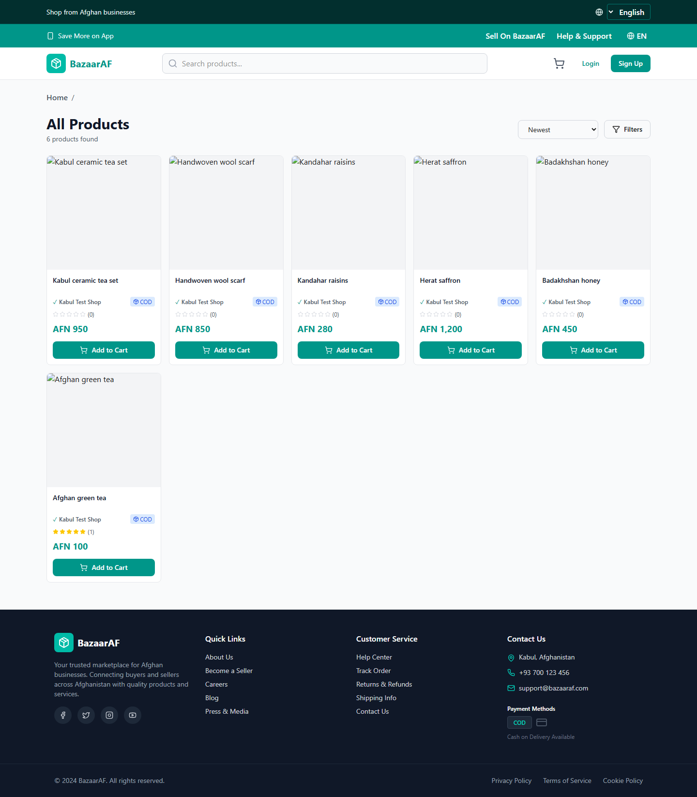
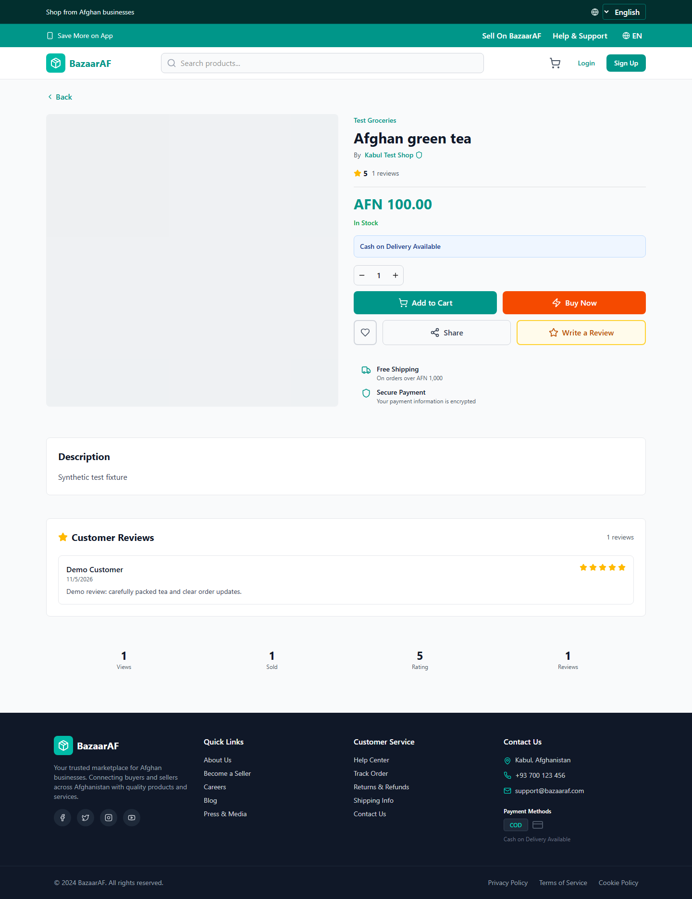
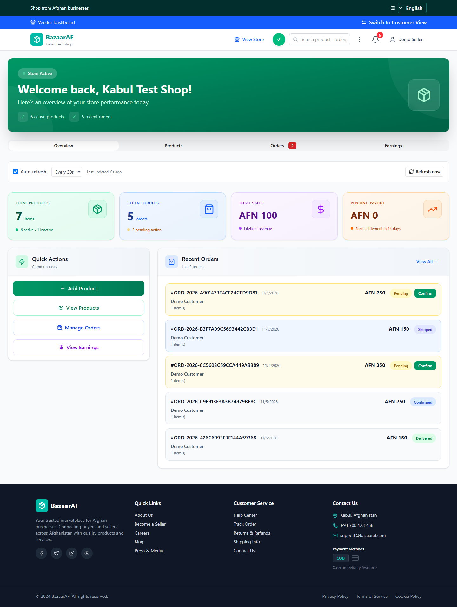
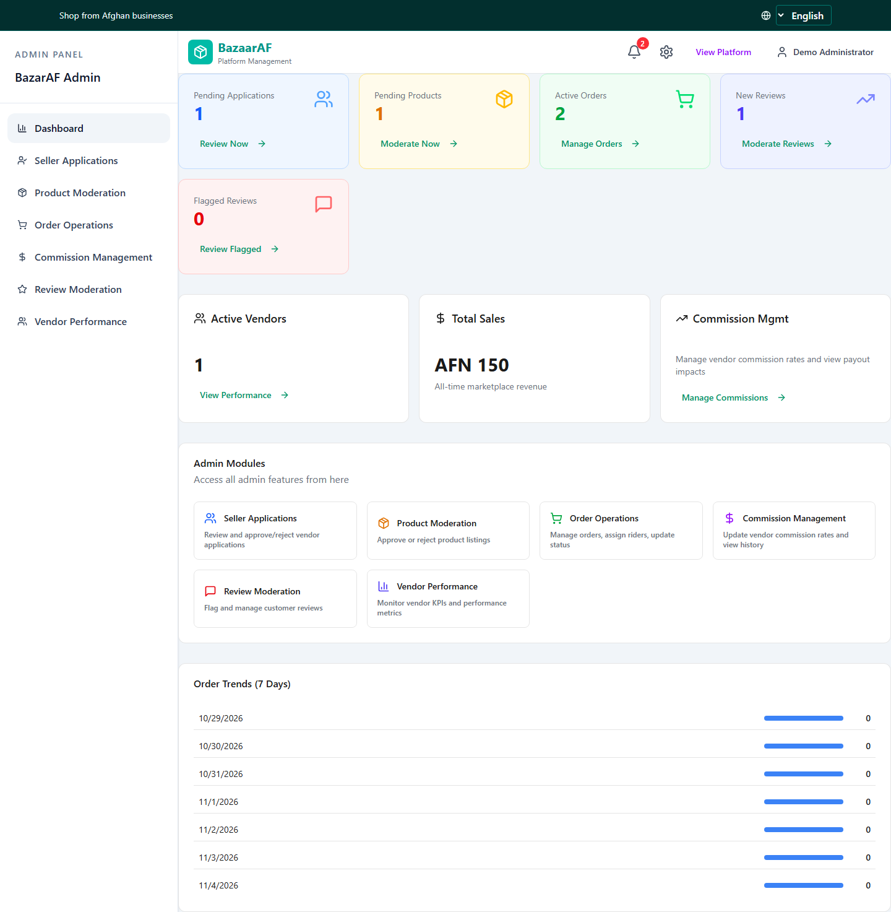
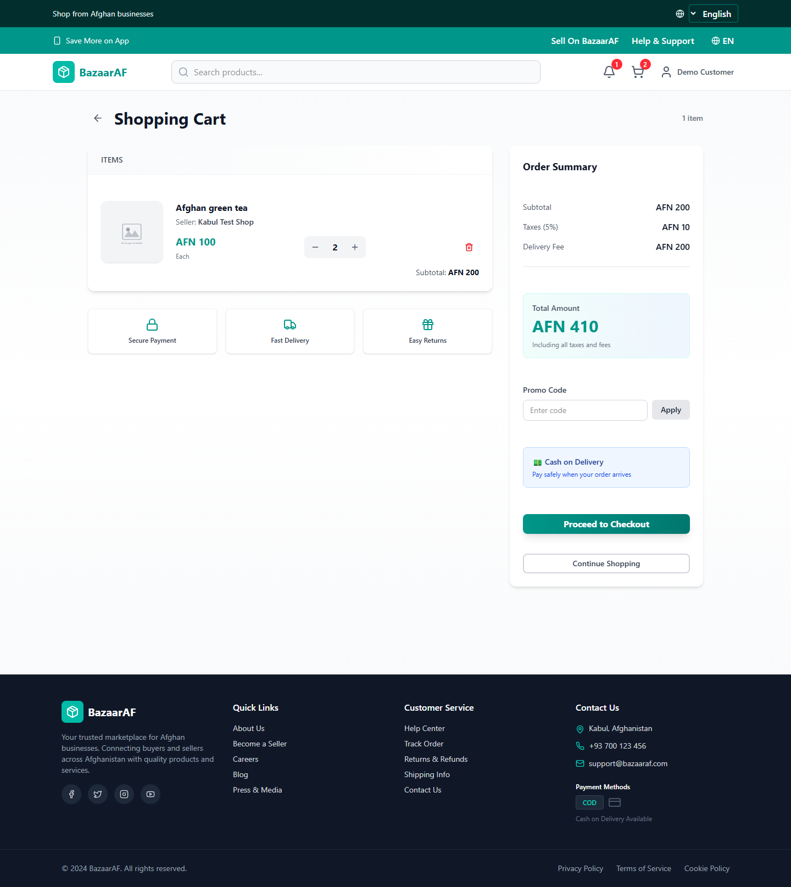
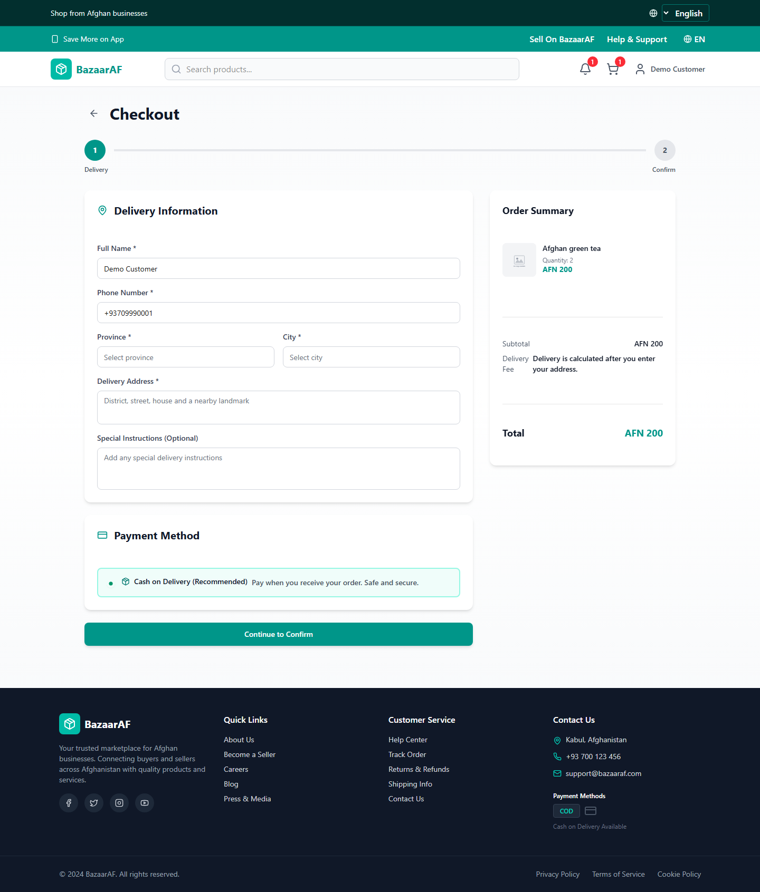
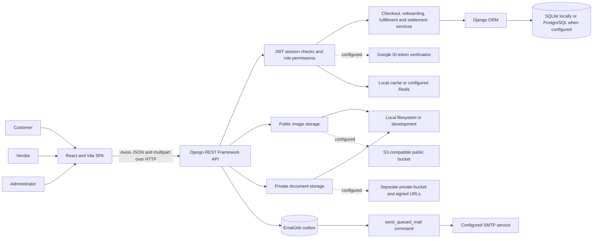
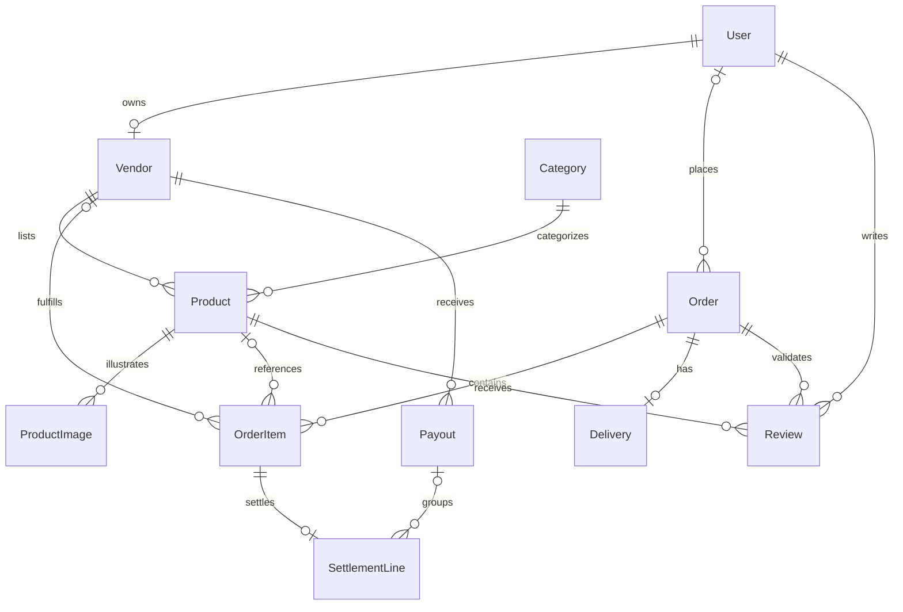
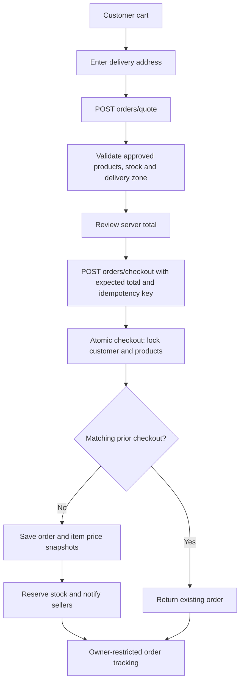

# BazarAF — E-commerce Marketplace

An Afghanistan-focused, multi-vendor marketplace with a React storefront, Django REST API, and separate customer, seller, and administrator workflows.


[Repository](https://github.com/NomanWahdat/BazarAF-E-commerce-Marketplace) · [Project audit](docs/PROJECT_AUDIT.md) · [Screenshot gallery](docs/SCREENSHOTS.md) · [API reference](docs/API_REFERENCE.md)

## Contents

- [Overview](#overview)
- [Screenshots](#screenshots)
- [Features and verification](#features-and-verification)
- [Technology stack](#technology-stack)
- [System architecture](#system-architecture)
- [Database design](#database-design)
- [Important workflows](#important-workflows)
- [Project structure](#project-structure)
- [Local setup](#local-setup)
- [API](#api)
- [Security](#security)
- [Testing](#testing)
- [Deployment](#deployment)
- [Limitations and next improvements](#limitations-and-next-improvements)
- [Engineering outcomes and attribution](#engineering-outcomes-and-attribution)
- [License](#license)

## Overview

BazarAF connects buyers with independent sellers through a shared product catalog. Customers browse products, keep a shopping cart, request a delivery quote, place cash-on-delivery orders, and review their purchases. Sellers submit listings and manage incoming orders. Administrators review seller applications and products, oversee fulfillment, and manage commission and payout records.

The application reflects its intended Afghan market through AFN pricing, Afghan phone normalization, province/city delivery zones, the `Asia/Kabul` backend timezone, and English, Dari (`fa`), and Pashto (`ps`) interfaces with right-to-left layout support. These are implemented product decisions; this repository does not establish nationwide delivery coverage, a payment-provider partnership, or real customer adoption.

**Verification snapshot — 5 November 2026:** the local source passed TypeScript checking, a Vite production build, 27 backend tests, and five Chromium tests. One additional backend test requires PostgreSQL and was skipped. The browser checkout test used a disposable SQLite backend with real API requests. The [audit](docs/PROJECT_AUDIT.md) records confirmed security and integrity issues that still need attention. This is a substantial portfolio project with a working local purchasing path, not a claim of production readiness.

## Screenshots

These are genuine captures of the application, using synthetic accounts and catalog data in a temporary database. They contain no production customer data. Product image placeholders and static homepage promotional content are the application's actual UI; they are not evidence of real sellers, testimonials, or sales. External image and third-party requests were blocked during capture.

| Storefront | Product details |
|---|---|
|  |  |

| Vendor dashboard | Administrator dashboard |
|---|---|
|  |  |

| Shopping cart | Checkout |
|---|---|
|  |  |

The [complete gallery](docs/SCREENSHOTS.md) includes the homepage, search, authentication forms, customer profile and orders, seller onboarding, storefront, vendor management, and administration pages. Capture dimensions, routes, and observations are in the [screenshot manifest](docs/evidence/screenshots.json). A rendered page alone does not verify every action on it.

## Features and verification

The complete evidence matrix is in [PROJECT_AUDIT.md](docs/PROJECT_AUDIT.md#feature-inventory). “Verified” below refers to the specific local tests and captures described, not every possible scenario.

### Customers

- Catalog browsing, product details, text search, category and price filters, sorting, and public storefronts. Pages rendered against the real local API; invalid-price filtering has a regression test.
- Browser-persisted cart and wishlist. The active storefront cart uses `localStorage`; separate database cart endpoints exist but are not the active cart's persistence layer.
- Cash-on-delivery checkout with server-computed prices and delivery fees, expected-total validation, stock reservation, and idempotency keys. Verified through backend regression tests and a browser purchase.
- Order history and owner-restricted tracking. Ownership rejection is tested; tracking uses API requests rather than a real-time push service.
- Profile and address management, purchase-linked reviews, notifications, and support/return requests are implemented in source. Their pages or API rules have partial verification; a support request does not issue a monetary refund.

### Vendors

- Seller application and direct vendor registration paths, private-document storage abstraction, and administrator approval. Seller approval has backend test coverage; document authorization has a confirmed issue described below.
- Product submission, category attributes, image upload, stock editing, and moderation status. Approved vendors can submit products; new products are forced to pending status in tested backend behavior.
- Dashboard, product and order tabs, order detail, seller-item confirmation, and earnings screens. These rendered against local data; shared-order item isolation and payout response formatting need fixes.
- Store branding, policies, notification preferences, profile settings, and TOTP two-factor authentication with hashed backup codes. The TOTP setup/login/backup-code flow has backend tests. SMS delivery is not integrated.

### Administrators

- Custom dashboard, seller application review, product moderation, order operations, commissions, review moderation, vendor performance, and category management.
- Django's administrative interface and a retained legacy React administration panel.
- Delivery/rider APIs and payout accounting, including settlement lines and recorded payment references. There is no dedicated rider frontend or automated bank transfer integration.

### Platform

- Custom phone-based users; customer, vendor, admin, and rider role values; JWT sessions and refresh rotation; permission checks and role-filtered querysets.
- English/Dari/Pashto resources, language persistence, RTL layouts, lazy-loaded routes, loading/error states, and an application error boundary.
- Relational models, migrations, an email outbox and worker command, configurable PostgreSQL and S3-compatible media, optional Redis, health endpoint, and CI definitions.

## Technology stack

| Layer | Verified technology | Role and qualification |
|---|---|---|
| Frontend | React 18.3.1, TypeScript 5.9, Vite 6.4.1 | Single-page application and build tooling |
| UI | Tailwind CSS 4.1.12, Radix/shadcn-style components, MUI, Lucide, Sonner | Styling, controls, icons, and feedback; see package manifest for full dependencies |
| Navigation and HTTP | React Router DOM 7, Axios | Client routing and shared API client with refresh coordination |
| Localization | i18next, react-i18next | English, Dari, Pashto, and RTL support |
| Backend | Python 3.13 target, Django 5.2.18, DRF 3.17.2 | HTTP API, business services, ORM, and administration |
| Authentication | SimpleJWT 5.5.1, custom AuthSession checks, pyotp | JWT rotation/revocation and vendor TOTP |
| Database | SQLite locally; PostgreSQL via `dj-database-url` and psycopg | SQLite was exercised; PostgreSQL concurrency was not |
| Storage | FileSystemStorage; django-storages and boto3 for S3-compatible storage | Public media and separate private-document bucket configuration; R2 is compatible but not verified as provisioned |
| Email / integrations | SMTP, durable EmailJob outbox, google-auth | Email worker and Google ID-token verification; external delivery and Google sign-in were not exercised |
| Operations | Gunicorn, WhiteNoise, Docker, Railway config, Vercel SPA rewrites | Repository configuration; current hosted deployment health is unverified |
| Quality | Django tests, Playwright, strict TypeScript, GitHub Actions | Local results below; no coverage percentage or hosted CI success is asserted |

Redis and Sentry are optional configuration paths in source. No Neon database URL, R2 endpoint, Redis URL, private bucket, or field encryption key was present in the local backend `.env` inspected for presence only. No secret values are documented. Earlier project documents mention Django 6 and older deployments; the current dependency lock targets Django 5.2.18.

## System architecture



The Django project is `Bazar`; the principal domain app is `home`, with an `api` URL package. This is a modular monolith with one database, not a microservice system. [Architecture and workflow details](docs/ARCHITECTURE.md) explain the actual boundaries and current inconsistencies.

## Database design



The [full database reference](docs/DATABASE.md) contains three ER diagrams covering **all 27 home models**, selected actual fields, primary/foreign keys, nullability, cardinality, constraints, indexes, and migration limitations. The machine-readable [model schema](docs/evidence/model-schema.json) lists every concrete field. User/group/permission and other framework tables are described separately rather than expanded in these domain diagrams.

## Important workflows



[Additional flowcharts](docs/ARCHITECTURE.md#workflows) cover registration/login/email verification/TOTP, seller product creation and moderation, vendor confirmation, order transitions, delivery cash collection, and settlement. The checkout row locks are implemented, but their concurrency guarantee requires PostgreSQL verification.

## Project structure

```text
BazarAF/
├── backend/
│   ├── Bazar/                 # Settings, HTTP entry points, isolated test settings
│   ├── api/urls.py            # API router and explicit routes
│   ├── home/
│   │   ├── models.py          # Marketplace entities
│   │   ├── admin_models.py    # Moderation, commission history, audit/stat models
│   │   ├── serializer.py      # API validation and representations
│   │   ├── views.py           # Main API and role permissions
│   │   ├── vendor_views.py    # Seller profile/settings/security
│   │   ├── admin_views.py     # Administrative workflows
│   │   ├── commerce.py        # Checkout, status transitions, settlement
│   │   ├── onboarding.py      # Transactional seller approval
│   │   ├── authentication.py  # JWT session issue/check/revocation
│   │   ├── storage.py         # Private document storage
│   │   ├── migrations/        # 0001–0022
│   │   └── management/commands/ # Email outbox worker and isolated demo seed
│   ├── .env.example
│   ├── requirements.in        # Runtime dependency intent
│   ├── requirements.txt       # Resolved dependency versions
│   ├── Dockerfile
│   └── railway.json
├── frontend/
│   ├── src/app/App.tsx        # Active frontend route composition
│   ├── src/app/components/    # Main dashboards, checkout and shared UI
│   ├── src/pages/             # Routed application pages
│   ├── src/services/          # API domain clients
│   ├── src/locales/           # Marketplace translation resources
│   ├── tests/marketplace.spec.ts
│   └── package.json
├── .github/workflows/        # Backend/frontend CI definition
├── docs/                    # Current audit, design references and screenshots
├── audit reports/           # Preserved earlier reports; some findings are superseded
└── roadmap/                 # Preserved product/business planning documents
```

## Local setup

Use a **fresh clone** for these instructions. Do not run migrations against a production database while exploring the project. These setup steps install the project's existing locked dependencies; no packages were installed or upgraded during this audit.

Prerequisites: Python **3.13**, Node **22.x LTS** (the manifest permits `>=22 <25`), npm, and Git. PostgreSQL is necessary to validate row-lock behavior but is not required for a basic local SQLite demo. The audit used existing Python 3.13.0 and Node 23.3.0 environments.

```powershell
git clone https://github.com/NomanWahdat/BazarAF-E-commerce-Marketplace.git
cd BazarAF-E-commerce-Marketplace
py -3.13 -m venv .venv
.\.venv\Scripts\Activate.ps1
python -m pip install -r backend/requirements.txt
Copy-Item backend/.env.example backend/.env
```

Edit `backend/.env` for a local environment. Keep `DEBUG=True`, leave `DATABASE_URL` empty to select a newly created `backend/db.sqlite3`, and use a newly generated local secret. The example contains safe values and empty integration settings. Django loads `.env` through python-dotenv; running backend commands from `backend/` makes this behavior explicit.

```powershell
cd backend
$env:PYTHONIOENCODING = 'utf-8'
python manage.py migrate
python manage.py createsuperuser
python manage.py runserver 127.0.0.1:8000
```

`createsuperuser` prompts for the custom phone and full-name fields. `PYTHONIOENCODING` avoids a confirmed Windows cp1252 failure caused by emoji output in migration 0009. Local migrations and test migrations were validated in isolation; commands must never point to an unintended database.

In a second terminal, from the repository root:

```powershell
cd frontend
Copy-Item .env.example .env.local
npm ci
npm run dev -- --host localhost --port 5173
```

The frontend example uses `VITE_API_URL=http://localhost:8000/api`. Open `http://localhost:5173/home`; the backend root and `/health/` are at port 8000. Use `localhost` consistently for this default setup: the backend's default CORS origins do not include every `127.0.0.1` frontend port. The audit used explicit CORS overrides for ports 5176/8001.

The migrations seed default categories, not a complete shop. Create an approved seller, approved products, and delivery zones through administrative tools for a useful local catalog. The isolated `seed_e2e` command described under [Testing](#testing) is intended only for disposable test databases.

For development email, absence of `EMAIL_HOST_USER` selects a console backend. Mail is queued in `EmailJob`; a separate process must execute:

```powershell
cd backend
python manage.py send_queued_mail
```

Console email includes verification codes/reset links, so keep development output private. Google sign-in additionally needs matching frontend/backend Google client IDs and authorized origins; real SMS transport is not implemented.

For PostgreSQL, set a connection URL belonging to a **disposable development database**. Normal settings require SSL for `DATABASE_URL`; the dedicated test PostgreSQL settings have their own `TEST_DATABASE_URL`. Use the sample's configuration names rather than copying credentials from another environment.

## API

API base: `/api/`. Authenticated calls normally send `Authorization: Bearer <access-token>`. A database-backed `AuthSession` must be active; an arbitrary SimpleJWT token without the session claim is insufficient.

| Area | Representative endpoints | Access |
|---|---|---|
| Identity | `POST auth/register/`, `auth/login/`, `auth/verify-email/`, `auth/token/refresh/` | Public credential/token flows with validation and throttling |
| Catalog | `GET products/`, `products/{slug}/`, `categories/tree/` | Public reads; approved-vendor writes and administrator moderation |
| Purchase | `POST orders/quote/`, `orders/checkout/` | Authenticated; server-calculated money and stock checks |
| Orders | `GET user/orders/`, `orders/track/{reference}/`; `POST orders/{uuid}/confirm/` | Buyer ownership / role-dependent seller and admin access |
| Seller | `vendors/profile/`, `vendors/settings/`, `vendors/2fa/...` | Vendor profile/security permissions |
| Administration | `admin/dashboard/summary/`, `admin/seller-applications/`, `admin/product-moderation/`, `admin/order-operations/` | Administrator role or superuser |
| Operations | `deliveries/`, `payouts/`, `support/`, `newsletter/` | Role-specific; newsletter submission public |

See [API_REFERENCE.md](docs/API_REFERENCE.md) for methods, identifiers, payload examples, response shapes, and known contract errors. There is no generated OpenAPI document configured; DRF's browsable API and router root are available when running locally.

## Security

Implemented safeguards include Django password hashing/validators in most registration and password-change paths, server-side role checks, owner-restricted tracking, JWT refresh rotation/blacklisting, session revocation, upload checks for product images and seller documents, separate private-document storage, short-lived signed URLs, TOTP backup-code hashes, configured encryption for TOTP secrets, and production HTTPS/configuration guards.

**Outstanding issues:** the vendor API exposes private serializer fields to customers; a valid signed document URL is then a bearer credential. Shared orders expose other sellers' items. Vendor profile email changes do not consistently reset verification, upload validation differs between product and branding paths, and some generic CRUD routes bypass business invariants. See the [prioritized findings](docs/PROJECT_AUDIT.md#confirmed-findings). These controls should be reviewed before using real identity documents or real orders.

`.env`, local databases, uploads, private documents, dependency environments, and test database infrastructure are excluded from the published source snapshot. The audit does not certify the absence of every possible secret or vulnerability.

## Testing

| Check actually run | Result | Scope |
|---|---|---|
| Django system checks | Passed | Isolated settings |
| Migration consistency | No changes detected | `makemigrations --check --dry-run` |
| Fresh SQLite migrations | Passed | Temporary databases only |
| Django test discovery | 28 discovered: 27 passed, 1 skipped | Admin governance, checkout regressions, TOTP; PostgreSQL concurrency skipped |
| `npm run typecheck` | Passed | Strict TypeScript over `src/` |
| `npm run build` | Passed | Temporary output directory; main JS chunk 651.73 kB, gzip 188.04 kB |
| `npm run test:e2e` with live isolated backend | 5 passed | Four UI/mock checks and one actual API checkout |
| Screenshot traversal | 31 initial route captures, plus supplemental captures | No page exceptions or API failures in initial traversal; actions require separate tests |

Backend commands, from `backend/` after activating the environment:

```powershell
$env:PYTHONIOENCODING = 'utf-8'
python manage.py check --settings=Bazar.test_settings
python manage.py makemigrations --check --dry-run --settings=Bazar.test_settings
python manage.py test home --settings=Bazar.test_settings --noinput
```

`Bazar.test_settings` disables dotenv loading, selects in-memory SQLite and local-memory mail/cache, and avoids configured cloud credentials. Some tests create synthetic document files; the audit additionally redirected storage into a temporary folder. [Verification details](docs/VERIFICATION.md) explain that wrapper and the evidence limits.

Frontend commands, from `frontend/`:

```powershell
npm run typecheck
npm run build
npm run test:e2e
```

The Playwright configuration starts Vite on `127.0.0.1:5176` with API port 8001. Its actual checkout case is skipped unless `BAZAAR_E2E_LIVE=1` and a seeded isolated backend is running. In a fresh disposable checkout, prepare it from `backend/`:

```powershell
python manage.py migrate --settings=Bazar.e2e_settings
python manage.py seed_e2e --settings=Bazar.e2e_settings
python manage.py runserver 127.0.0.1:8001 --settings=Bazar.e2e_settings --noreload
```

Then in the frontend terminal:

```powershell
$env:BAZAAR_E2E_LIVE = '1'
npm run test:e2e
```

`Bazar.e2e_settings` uses `backend/.e2e.sqlite3`, not the default application database. Never expose its fixed synthetic test accounts publicly. The audit used a separate temporary database rather than overwriting any existing `.e2e.sqlite3`.

For an explicitly disposable PostgreSQL server, set `TEST_DATABASE_URL` privately and run `python manage.py test home --settings=Bazar.test_postgres_settings --noinput`. Django creates/drops its test database, so the database user must have suitable permissions and must not be directed at production. This command was inspected but not executed during the audit.

## Deployment

The most recent local backend configuration targets **Railway using Docker/Python 3.13**, with Gunicorn, pre-deploy migrations, `/health/`, and restart policy. The frontend includes a **Vercel SPA rewrite**. A legacy backend Vercel configuration still specifies Python 3.12; it conflicts with the current runtime target and must not be treated as the validated deployment path.

With `DEBUG=False`, settings require PostgreSQL, Redis, public S3-compatible credentials/endpoint, a separate private-document bucket, a field encryption key, an SMTP username, and an HTTPS frontend URL. SMTP authentication, Redis reachability, bucket privacy/CORS, key validity, backups, and worker operation still need actual environment checks. The checked-in Railway configuration does **not** provision these services or start the email worker.

The Docker build performs static collection; migrations run once as Railway's pre-deploy command. An email worker must run separately. No deployment was triggered, and no cloud database or storage was changed in this audit. Historical URLs in earlier documentation are preserved as historical references, not verified live demonstrations.

## Limitations and next improvements

Current limitations include browser-only wishlist/cart state, no online payment gateway, no rider UI, no live courier integration, no SMS transport, partial translation/accessibility verification, static homepage promotional content, and incomplete email-worker deployment configuration.

The first five implementation priorities are:

1. **P0 — Fix vendor document exposure:** apply public serializers to public/customer reads and enforce document ownership/administrative authorization before issuing links.
2. **P1 — Isolate shared-order seller data:** return seller-scoped line items and totals, with negative multi-vendor tests.
3. **P1 — Protect order/inventory accounting:** replace or constrain generic order deletion; verify cancellation, reservations, and settlement across every mutation path.
4. **P1 — Repair financial contracts:** normalize payout pagination, use Decimal consistently in previews, and validate commission bounds/effective-date behavior.
5. **P1 — Make local-to-production verification reproducible:** run PostgreSQL concurrency/integration checks and validate the email worker, private storage, Redis, and production configuration together.

After these fixes, valuable additions are cross-device cart/wishlist synchronization, a complete support/returns process, focused accessibility/mobile tests, and clear CI evidence. A payment gateway should follow a genuine local business need and a verified provider integration. The [audit roadmap](docs/PROJECT_AUDIT.md#prioritized-roadmap) includes complexity, dependencies, and acceptance criteria; no recommended application changes were implemented as part of documentation work.

## Engineering outcomes and attribution

This project demonstrates frontend/API integration, relational schema design, multi-role authorization, transactional purchasing logic, stock and money snapshots, moderation workflows, TOTP/session management, media boundaries, localization, and automated regression testing. Its strongest portfolio presentation is a reproducible technical case study that also explains defects and tradeoffs.

The existing [resume document](RESUME_PROJECT.md) identifies BazarAF as a **group project**. Preserve that attribution in scholarship applications: describe personal responsibilities using your own verifiable contribution history. This audit does not establish sole authorship or invent individual contributions, traffic figures, customer counts, performance results, or coverage percentages.

The frontend's original design attribution remains in [frontend/README.md](frontend/README.md), and third-party notices remain in [frontend/ATTRIBUTIONS.md](frontend/ATTRIBUTIONS.md). Earlier [project documentation](PROJECT_DOCUMENTATION.md), [integration guide](INTEGRATION_GUIDE.md), [production audit](PRODUCTION_AUDIT.md), and reports under `audit reports/` are retained; use the dated audit in `docs/` for current verification results.

## License

No project-level license file was found. No license has been added or inferred. Existing third-party attribution does not establish a license for this application; the owner should choose one explicitly before describing it as open source.
