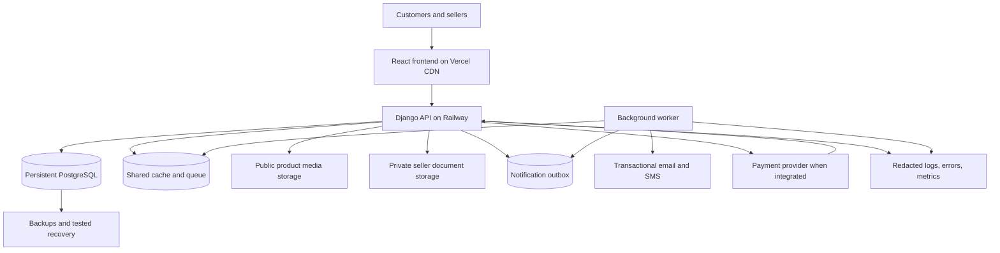

# BazaarAF production readiness audit and deployment guide

**Review date:** 23 October 2026, Asia/Kabul  
**Project:** BazaarAF / BazarAF, marketplace for Afghanistan  
**Scope:** Current local source, configuration, migrations, existing tests, customer and seller flows, administration, deployment, and proposed enhancements.  
**Changes made:** This report only. Application source, dependencies, migrations, existing databases, and cloud resources were not changed.

## 1. Executive assessment

**The current code should not be opened to unrestricted production trading yet.** It has substantial marketplace functionality, but confirmed authorization, privacy, checkout, seller approval, and database bootstrap defects need to be fixed first. These are more urgent than a visual redesign or a change of hosting provider.

The most serious findings were reproduced locally with synthetic accounts:

1. A customer could change **another buyer's order** to delivered through the bulk status endpoint.
2. A product priced at **100 AFN** could be ordered with a submitted price and total of **1 AFN**.
3. A pending seller could create an **approved** product without admin approval.
4. Anonymous visitors could receive **seller identity/business document URLs** through product details.
5. Anonymous order tracking returned **customer details and a delivery address**.
6. A vendor could mark their own payout as **paid**.
7. Replaying the database migrations from an empty database failed on **duplicate category slugs**.

**Recommended deployment direction:** Retain **Vercel for the React frontend and Railway for the Django backend** for the initial production launch. Add persistent PostgreSQL, shared cache/queue infrastructure, separate public and private object storage, reliable background delivery, backups, monitoring, and a staging environment. This architecture fits the existing application. Moving hosting alone will not resolve the defects above.

Treat the initial launch as a controlled marketplace pilot in an explicitly supported delivery area. Expand after successful real order, delivery, return, and seller settlement cycles.

### Reading guide

- Sections 2–4 explain the application, review evidence, and release blockers.
- Sections 5–8 describe authentication, seller, commerce, frontend, and maintainability work.
- Sections 9–10 describe Afghanistan-specific requirements and feature priorities.
- Sections 11–13 provide the target architecture and deployment instructions.
- Sections 14–16 provide testing, sequencing, and launch acceptance criteria.
- Section 17 identifies what is already improved and corrects outdated documentation.

## 2. What the project currently contains

### 2.1 Architecture and ownership of data

| Area | Current implementation | Assessment |
| --- | --- | --- |
| Frontend | React 18.3.1, TypeScript source, Vite, React Router | Appropriate foundation; needs route, state, contract, and bundle work |
| UI | Tailwind 4, Radix/shadcn-style components, MUI and other libraries | Broad interface coverage; overlapping libraries add maintenance cost |
| Backend | Django, Django REST Framework, SimpleJWT | Appropriate modular monolith foundation |
| Database | SQLite fallback; PostgreSQL through `DATABASE_URL` | Production must explicitly require persistent PostgreSQL |
| Authentication | Phone/email password login, Google ID-token login, vendor TOTP/backup codes | Multiple entry points enforce different policies |
| Seller onboarding | Application upload, multiple approval implementations, vendor profile | Needs one authoritative application/approval service |
| Catalog | Categories, category attributes, products, images, moderation | Approval and public visibility enforcement are incomplete |
| Commerce | Local browser cart, backend cart API, COD checkout, orders, deliveries, payouts | Needs authoritative pricing, inventory, state transitions, and accounting |
| Admin | React admin pages, legacy admin panel, Django admin | Useful coverage; duplicated paths have inconsistent behavior |
| Languages | English, Dari (`fa`), Pashto (`ps`), RTL support | Implemented foundation; important pages still contain English and ASCII-only identifiers |
| Notifications | Database notifications and threaded email | Some operational UI promises exceed implemented delivery capabilities |
| Infrastructure | Railway Procfile/build script; frontend and backend Vercel config | Historical deployment approaches coexist; production target needs documenting |

Principal models include `User`, `Vendor`, `SellerApplication`, `Category`, `Product`, `ProductImage`, category/product attributes, `Order`, `OrderItem`, `Delivery`, `Payout`, `Address`, `Review`, `Cart`, `Notification`, commission history, review moderation, and vendor audit logs.

### 2.2 Important source locations

| Responsibility | Source |
| --- | --- |
| Backend settings and storage | `backend/Bazar/settings.py` |
| API routes | `backend/api/urls.py` |
| Main permissions, login, catalog, checkout, orders, payouts | `backend/home/views.py` |
| Validation and API data contracts | `backend/home/serializer.py` |
| Persistent entities and deletion behavior | `backend/home/models.py` |
| Vendor settings, 2FA, session display, SMS stub | `backend/home/vendor_views.py` |
| Admin workflow implementations | `backend/home/admin_views.py`, `backend/home/admin_models.py` |
| Automatic vendor creation and notifications | `backend/home/signals.py` |
| Email transport | `backend/home/emails.py` |
| Migration history | `backend/home/migrations/0001_*` through `0019_*` |
| Frontend routing and cart ownership | `frontend/src/app/App.tsx` |
| HTTP client and token refresh | `frontend/src/services/api.ts` |
| Login and signup | `frontend/src/pages/Login.tsx`, `SignUp.tsx` |
| Checkout and tracking | `frontend/src/app/components/Checkout.tsx`, `OrderTracking.tsx` |
| Seller application | `frontend/src/pages/SellerRegistration.tsx` |
| Catalog and storefront | `frontend/src/pages/ProductListing.tsx`, `ProductDetail.tsx`, `StoreFront.tsx` |
| Vendor and administration interfaces | `frontend/src/app/components/VendorDashboard.tsx`, `frontend/src/pages/Admin*.tsx` |
| Language resources | `frontend/src/i18n.ts`, `backend/locale/` |

### 2.3 Existing strengths to preserve

- Backend permissions and user-scoped querysets already exist for many resources.
- Password hashing uses Django's authentication framework.
- The production secret key is required rather than silently defaulting to a known key.
- HTTPS, secure-cookie, HSTS, and content-type settings exist for production.
- CORS uses an explicit frontend allowlist rather than globally allowing every origin.
- Checkout requires authentication, checks the account phone, checks stock, and checks seller approval for existing products. Those checks are valuable but do not make the current checkout safe overall.
- Seller approval, product moderation, notification, commission-history, and audit-log foundations exist.
- TOTP enrollment, hashed backup codes, and a signed challenge flow are implemented.
- Core money columns use decimal fields.
- Category attributes, seller branding, reviews, saved addresses, and multilingual UI foundations exist.
- An error boundary and a real placeholder SVG exist.

Keep the application as a modular monolith while correcting its behavior. Microservices, Kubernetes, or a full framework rewrite are unnecessary for the initial launch.

## 3. Review method and verification results

### 3.1 What was checked

The review traced the main customer, seller, admin, and delivery paths across routes, views, serializers, models, signals, frontend components/services, migrations, settings, and deployment files. Existing audits, integration notes, project documentation, and roadmaps were used as background and checked against current source rather than treated as current facts.

Runtime probes used **synthetic accounts in an in-memory SQLite database**, temporary media storage, disabled `.env` loading, and an in-memory email backend. No emails, SMS, payments, or production API mutations were sent. Existing SQLite files were not used for these probes.

No live Railway/Vercel account inspection, live customer browser session, PostgreSQL concurrency test, external payment transaction, full accessibility review, or external vulnerability scan was performed. Consequently, findings below distinguish reproduced behavior, source-confirmed issues, deployment conditions, and proposed enhancements. Passing a local probe is not a production certification.

### 3.2 Toolchain mismatch

| Component | Repository declaration | Runtime used for local checks |
| --- | --- | --- |
| Python | `backend/runtime.txt`: Python 3.12 | Root `.venv`: Python 3.13.0 |
| Django | `requirements.txt`: 4.2.7 | 6.0.5 |
| Django REST Framework | 3.14.0 | 3.17.1 |
| SimpleJWT | 5.2.2 | 5.5.1 |
| Gunicorn | 21.2.0 | 26.0.0 |
| django-storages | Declared | Not installed in root `.venv` |
| google-auth | Declared | Not installed in root `.venv` |
| Node | No engine pin in frontend package | 23.3.0 |
| Vite | `^6.4.1` | Build reported 6.4.1 |

These differences must be resolved before relying on local tests to predict deployment behavior. The project also contains multiple virtual-environment directories. Select one documented environment and reproduce it in CI and staging.

### 3.3 Recorded results

| Check | Result | Meaning |
| --- | --- | --- |
| Frontend production build | **Passed** using existing dependencies and temporary output | Bundle generation succeeds; this does not perform TypeScript type checking |
| Build size | Main JS **1,156.49 kB**, gzip **293.32 kB**; CSS **162.35 kB**, gzip **23.73 kB** | Route splitting and mobile performance work are warranted |
| Django deployment checks | **No issues** in isolated production-style settings | A narrow settings check; it does not detect the business/security defects below |
| Model/migration state check | `makemigrations home --check --dry-run`: **No changes detected** | Current migration state matches models; replay can still fail |
| Normal backend test run | **Blocked during database setup** by duplicate category slug uniqueness failure | Fresh deployment/bootstrap is broken in the checked environment |
| Diagnostic backend tests | **10/10 passed**, 169.053 seconds | Only after explicitly bypassing `home` migration history and synchronizing current models; not a normal suite pass |
| TypeScript/lint/browser suite | Not run; no configured scripts and no local TypeScript compiler found | Build success must not be presented as type, lint, or browser verification |

The first frontend build attempt hit a filesystem sandbox access error; the same existing build passed when permitted to access the necessary directories. An alternative config-loader attempt was diagnostic only. The first Python test attempt hit Windows console encoding on an emoji in a data migration; rerunning with UTF-8 exposed the substantive migration failure. These environment obstacles are separate from application defects.

### 3.4 Reproduced application behavior

| Scenario with synthetic data | Observed result |
| --- | --- |
| Customer bulk-updates a different customer's order | HTTP 200; other order persisted as `delivered` |
| Customer directly patches own order from pending to delivered | HTTP 200; `delivered` persisted |
| Checkout submits line price/total 1 for a product priced at 100 | HTTP 201; saved line price and total both `1.00` |
| Checkout references a nonexistent product UUID | HTTP 201; order item saved with no product |
| Pending vendor creates product with `status=approved` | HTTP 201; product saved as approved |
| Anonymous product-detail request | HTTP 200; nested vendor contained identity/business document URL fields |
| Anonymous tracking request | HTTP 200; returned customer, phone, address, notes, and items |
| Vendor marks own payout paid | HTTP 200; payout persisted as paid |
| Public direct vendor registration | HTTP 500; vendor auto-creation conflicts with explicit vendor creation |
| New React-admin seller approval API | HTTP 400; `UNIQUE constraint failed: home_vendor.user_id` |
| Profile email changed to another account's email | HTTP 200; duplicate email created; verification flag stayed true |
| Review submitted for an unpurchased product using an owned delivered order | HTTP 201; review created despite zero order items |
| Legacy 2FA-disable endpoint without password/TOTP | HTTP 200 |
| JWT logout with a valid refresh token | HTTP 400 |
| Logout all sessions, followed by another request with the same token | Both HTTP 200; token remained usable |
| Standard JWT token endpoint with valid phone/password | HTTP 401; backend ignores the `phone` keyword |
| Product action `toggle_featured` through slug route | TypeError: unexpected `slug` keyword |
| Product sorting by `average_rating` | HTTP 500 |
| Invalid numeric price filter | HTTP 500 |
| Legacy order creation with an actual UUID product ID | HTTP 400; integer ID serializer mismatch |

## 4. P0 — release blockers

**Priority definitions:** P0 blocks public trading; P1 must be addressed before a dependable production launch; P2 is important for quality and growth; P3 is optional expansion. Priorities indicate release order, not a numerical security scoring system.

### P0-01 — Checkout trusts browser prices and totals

**Evidence:** `backend/home/serializer.py:765`, `CheckoutOrderSerializer.create()`; `frontend/src/app/components/Checkout.tsx`.

The serializer stores `validated_data['total']` as the order total and `item_data['price']` as each line's price. It accepts subtotal/delivery fee without reconciling them. A synthetic 100 AFN product was successfully ordered for 1 AFN. The items field is an untyped list rather than a nested validated line serializer. A nonexistent product is converted into an order item without a product/vendor instead of being rejected.

**Required work:** Accept product/variant identifiers and positive quantities. Fetch canonical product names, prices, availability, seller state, supported payment method, delivery charges, discounts, and applicable taxes on the server. Persist a breakdown and immutable line snapshots. Reject unknown products and malformed items with 4xx responses. Define currency as AFN explicitly. Recalculate the final amount in one service used by every checkout path.

**Acceptance:** Altering submitted prices, totals, seller IDs, names, or delivery fees cannot alter the server-calculated charge. Invalid, zero, missing, or excessive quantities and nonexistent products produce no order or stock mutation.

### P0-02 — Custom order actions bypass intended authorization

**Evidence:** `backend/home/views.py:1717`, `OrderViewSet.get_permissions()` and `bulk_update_status()`.

`get_permissions()` replaces the permissions declared on custom actions with its own fallback of `IsAuthenticated`. The bulk updater then uses `Order.objects.filter(...)`, without applying the caller's scoped queryset. A customer changed a different customer's order to delivered. Global order counts are also available through a custom action with insufficient role restriction.

**Required work:** Define explicit permissions for every action, preserve intended action restrictions, deny unrecognized actions by default, and scope all mutations. Audit the same pattern in vendor, payout, product, and delivery viewsets. A decorator alone is not protection when overridden.

**Acceptance:** Anonymous users, customers, unrelated vendors, and unrelated riders cannot invoke administrative actions or affect another party's order; cover both single and batch operations.

### P0-03 — Public product responses expose seller documents

**Evidence:** `backend/home/serializer.py:142` and `:453`, `VendorSerializer` nested in public product details; `backend/Bazar/settings.py`; `backend/Bazar/urls.py`.

The public product-detail response includes the vendor's identity and business document URLs alongside nested user information and internal fields. The same default storage serves public product images and identity documents. Settings disable signed URL authentication globally and configure a public-read ACL. Local `/media/` URLs are served without an application permission check.

**Required work:** Create a small public vendor serializer. Put identity/business documents in a distinct private storage location with per-request authorization and short-lived downloads for approved staff. Keep public product assets separate. Remove private fields from public catalog, search, featured, storefront, and tracking payloads. Record administrative document access and retention/deletion rules.

**Acceptance:** Anonymous users and ordinary customers receive no identity-document paths or URLs. Direct unauthenticated downloads fail. Public image access continues to work.

### P0-04 — Public tracking exposes order/customer information

**Evidence:** `backend/home/views.py:1981`, `OrderDetailByIdView.permission_classes = [AllowAny]`; `OrderSerializer`; `Order.save()` in `models.py`.

Knowing the order reference is enough to receive the customer's nested account details, phone, delivery address, notes, and complete order. References contain only a six-hex-character random suffix after the year; they are not appropriate bearer secrets, and the namespace also creates a growing collision risk without retry handling.

**Required work:** Require buyer ownership for full order access. If guest/public tracking is a product requirement, use a separate high-entropy, expiring tracking credential or verified-phone flow, minimal status-only output, and dedicated throttling. Keep order references distinct from authorization credentials.

**Acceptance:** An unrelated visitor who knows an order number cannot receive personal data. Legitimate customers can refresh/bookmark their own tracking page safely.

### P0-05 — Seller and product approval can be bypassed

**Evidence:** `backend/home/serializer.py:583` and `:385`; `backend/home/views.py:1248`; `RegisterSerializer` permits vendor registration.

Vendor-facing create/update serializers expose `status` and update exposes `is_featured`. Product creation checks for a vendor role/profile, not approved vendor status. Public catalog filtering checks the product's approval/activity but omits `vendor__status='approved'`. A pending vendor created an approved product in the isolated probe.

**Required work:** Server-control moderation and marketplace promotion fields. Separate seller-editable fields from staff-only fields. Enforce approved seller status for publication and relevant operations. Consistently hide suspended sellers' products. Define which material product edits require another review. Self-registering as a vendor/rider must not grant operational privileges.

**Acceptance:** Pending/suspended sellers cannot publish or self-approve. A seller cannot select an approved status or marketplace featured placement. Approval and suspension work across all catalog/search/category paths.

### P0-06 — Vendors can mark their own payout paid

**Evidence:** `backend/home/views.py:2165`, `PayoutViewSet.get_permissions()` and `mark_paid()`.

The action's admin-only decorator is overridden by the same fallback permission pattern. A vendor who can retrieve their own payout can invoke `mark_paid`; the probe returned 200 and persisted `paid`.

**Required work:** Restrict settlement changes to authorized finance/admin roles. Separate an operational payment instruction from verified execution and reconciliation. Record actor, amount, method/reference, approvals, and immutable ledger entries. Make payout execution idempotent. Require stronger confirmation for financial actions.

**Acceptance:** A seller can view their settlement statement but cannot change settlement status, balances, commission, or paid timestamps. Retrying payment cannot pay twice.

### P0-07 — Empty-database migration replay fails

**Evidence:** `0009_create_default_categories.py`, `0010_add_missing_fields.py`, `0019_alter_productimage_options_and_more.py`.

Migration 0009 seeds categories. Migration 0010 adds slugs with an empty default. Migration 0019 makes slugs unique without first backfilling unique values. The ordinary test runner fails with `UNIQUE constraint failed: new__home_category.slug`. An existing database may have been manually repaired; that does not make a clean deployment reproducible. Product slug uniqueness has the same backfill concern for existing products.

**Required work:** Repair the migration/bootstrap strategy on an isolated branch; include deterministic unique slug backfills before enforcing uniqueness. Account for installations where historical migrations have already been applied. Test both empty-database replay and upgrade of a realistic sanitized snapshot. Plan migration-history reconciliation deliberately; do not blindly delete migrations, edit production history, drop the database, or use `--fake` to conceal the problem.

**Acceptance:** Fresh PostgreSQL bootstrap, fresh test-database creation, and an upgrade from the deployed schema all complete automatically with valid, unique slugs.

## 5. P1 — authentication and account reliability

### P1-01 — Signup bypasses email ownership verification

**Evidence:** `backend/home/views.py:401`, `RegisterView`; frontend `SignUp.tsx`.

An explicitly labeled demo branch sets `email_verified=True` and immediately issues JWTs. The serializer still generates and sends a verification code, so the UI and backend policies disagree. Signup redirects to home regardless of a future verification-required response.

Remove the demo behavior and define one verification policy. If low-friction browsing is allowed, represent unverified accounts honestly and restrict sensitive operations until ownership is proven. Update signup routing and user messages. Do not mark an email verified merely because it was supplied.

### P1-02 — Login errors trigger inappropriate refresh and navigation

**Evidence:** `frontend/src/services/api.ts`, response interceptor; `Login.tsx`.

Every 401 triggers token refresh, including bad credentials, an email-verification requirement, and invalid 2FA. When there is no usable refresh token, the interceptor clears state and changes `window.location`, interfering with the login component's error and verification handling. Concurrent expired requests also trigger independent refreshes.

Exclude authentication/challenge/reset endpoints from refresh handling. Refresh only an authenticated session whose access token expired, coordinate one in-flight refresh, propagate the original authentication error to the page, and preserve a return-to destination. Add bounded HTTP timeouts and consistent cancellation/error handling for unreliable networks.

### P1-03 — Standard JWT login endpoint is broken; policy is fragmented

**Evidence:** `/api/auth/token/` in `backend/api/urls.py`; `backend/home/auth_backend.py`; custom login at `views.py:206`.

SimpleJWT supplies the custom username field as `phone`. `PhoneAuthenticationBackend.authenticate()` only uses `username`; if it is absent, authentication returns `None`. The isolated request with correct phone/password returned 401. This endpoint is **not a confirmed working 2FA bypass in the current configuration**. If its keyword handling is corrected alone, its default token issuance still will not automatically inherit custom verification/2FA policy.

Choose one authoritative authentication service. Remove unused token-issuing routes or make every supported route enforce identical active-user, verification, MFA, and seller-state rules. Test Django-admin authentication separately.

### P1-04 — Google sign-in skips the vendor 2FA policy

**Evidence:** `backend/home/views.py:448`, `GoogleAuthView`.

After verifying a Google token and matching an account by email, this path directly issues JWTs rather than invoking the vendor TOTP challenge used in password login. It also creates synthetic real-looking `+93` phone numbers for new Google accounts.

Apply the same post-identity login policy to Google and passwords. Model the provider identity using its stable subject, validate verified-email assertions before account linking, and make account linking intentional. Require a real phone collection/verification step before checkout or seller operations instead of assigning a number that could belong to someone else. Google behavior was inspected in source; a real external OAuth exchange was not run.

### P1-05 — Logout and session-management UI do not revoke access

**Evidence:** `LogoutView` at `views.py:543`; `INSTALLED_APPS` in settings; `vendor_views.py:943` and `:974`.

`LogoutView` calls `token.blacklist()` but the SimpleJWT blacklist application is absent. Valid logout returned 400. Vendor session removal only edits a cached display list. A subsequent request with the same token still succeeded after “logout all sessions.” Access-token JTIs are used as display-session identifiers, so token refresh is also not a stable device-session model.

Implement actual refresh-token revocation/rotation and a persistent device-session or session-version mechanism. Define whether existing access tokens must be invalidated immediately. Apply it to password changes, resets, compromised accounts, and account suspension. Add blacklist cleanup if that design is chosen. Verify refresh-token ownership on logout. UI success messages must reflect real invalidation.

### P1-06 — Legacy endpoint disables 2FA without reauthentication

**Evidence:** `backend/home/vendor_views.py:618`, `Toggle2FAView`.

This authenticated endpoint clears TOTP/backup-code state without a password or second-factor challenge; a probe returned 200 without either. It coexists with the newer, stronger disable flow.

Remove or harden the legacy path and require recent authentication plus appropriate MFA proof/recovery authorization. Protect setup reset, backup-code regeneration, email changes, and settlement changes with the same deliberate policy. Encrypt recoverable TOTP secrets at rest, restrict staff exposure, and make challenge/backup-code consumption atomic to prevent concurrent reuse.

### P1-07 — Password reset accepts an arbitrary frontend origin

**Evidence:** `backend/home/views.py:641`; `RegisterSerializer`; vendor verification sender.

Password-reset mail constructs its link from request-supplied `frontend_url`. Signup and some verification senders also accept a client URL. A trusted-looking email can consequently contain a token-bearing link to an untrusted host. A code/link should never choose its destination from an unauthenticated arbitrary origin.

Use canonical, environment-controlled frontend URLs or an explicit preview allowlist. Encode query parameters properly and redact tokens from logs. Use generic, consistent reset responses and canonical email matching. Keep reset links single-use and expiring.

### P1-08 — Profile updates allow duplicate emails and retain verification

**Evidence:** `User.email` is not unique; `UserProfileSerializer` at `serializer.py:1123`; `UserUpdateSerializer`; vendor profile updates.

The profile endpoint accepted another user's email and kept `email_verified=True`. Several lookup paths assume a single email: some use `.first()`, others `.get()`, and password reset uses case-sensitive matching. This creates identity ambiguity, incorrect Google matching, and reset errors.

Normalize before validation and lookup, enforce case-insensitive uniqueness for nonempty emails in the database, and resolve existing duplicates with an ownership-safe migration. Require verification for an email change and notify the old address. Apply the same rules across every profile/admin/import path.

### P1-09 — OTP, password, and phone validation are inconsistent

**Evidence:** `User.generate_email_verification_token()` / `verify_email_token()`; public verification/resend views; `ChangePasswordSerializer`; reset view; `PhoneValidator` and repeated frontend normalizers.

Email verification uses a six-digit code with a 24-hour lifetime and no dedicated per-account attempt budget or public resend cooldown. Verification can also search by code without an email, despite codes not being globally unique. General API throttles alone do not solve this. Signup, reset, customer password change, vendor password change, and direct vendor registration enforce different password rules. Phone format handling is duplicated; bare `93...` and Persian/Pashto digits are not normalized consistently.

Use one normalization/validation service, a verified email/code pair or high-entropy link token, short OTP validity, hashed codes, per-account and IP attempt budgets, resend cooldowns, and shared counters. Apply Django password validators consistently, including the target user. Normalize locale digits and supported Afghanistan phone forms before uniqueness checks. Decide how phone-only accounts recover access.

### P1-10 — Shared cache is missing for security state

**Evidence:** cache use in main/vendor views; no `CACHES` setting in `backend/Bazar/settings.py`.

The default process-local cache stores MFA challenges, rate counters, phone codes, cooldowns, and session display data. A challenge created in one worker may fail verification in another; restarts discard it, and limits differ per process. The one-worker Procfile currently masks some of this limitation.

Configure a shared production cache before adding workers or replicas. Use atomic increment/consume operations where required. Separate security state and durable job delivery from an evictable catalog cache. Expose neither Redis nor database ports publicly without need. Simply adding `REDIS_URL` will not work until Django is configured to read it.

### P1-11 — Browser auth relies on editable local storage

**Evidence:** `frontend/src/utils/auth.ts`, `ProtectedRoute.tsx`, login/signup, shared API client.

Route guards treat token presence as authentication and use a locally stored role. Corrupt JSON can throw; stale roles persist after seller approval. Browser storage exposes tokens to any successful same-origin script injection. Client-side role checks are useful navigation controls but cannot enforce backend authorization.

Centralize auth state, restore it from a real current-user endpoint, handle corruption/expiration, and synchronize logout across tabs. Fix `authAPI.getCurrentUser()`, which calls `/auth/user/` even though the current routes do not define it. Consider a secure HttpOnly-cookie session/refresh design with appropriate CSRF protection; if retaining bearer tokens, document the tradeoff and harden CSP and token lifetime/revocation.

## 6. P1 — seller, catalog, commerce, and finance correctness

### P1-12 — Seller creation and approval paths conflict

**Evidence:** `VendorCreateSerializer` at `serializer.py:204`; `home/signals.py`; `SellerApplicationViewSet` at `views.py:970`; `SellerApplicationAdminViewSet` at `admin_views.py:378`; `frontend/src/services/adminService.ts`.

Saving a vendor-role user triggers a signal that creates a vendor profile. Direct vendor registration and the newer admin approval flow then explicitly create another profile for the same one-to-one user. Both paths failed in local probes. The newer admin endpoint also always creates a new user rather than supporting an existing applicant, and contains a predictable temporary-password formula derived from the phone number. The React admin uses this newer path, while existing approval tests exercise the older path.

Consolidate onboarding into one transactional, idempotent service. Reuse the authenticated, ownership-verified applicant; create/update the vendor once. Stop auto-repairing business state in dashboard GET requests. Use a secure account-activation/password-setup link instead of predictable or emailed passwords. Test the exact endpoint used by the current UI, including an existing customer, a new applicant, reapplication, duplicate clicks, approval email failure, and concurrent review.

### P1-13 — Application ownership and applicant access are incomplete

**Evidence:** public `SellerApplicationViewSet.create`, application serializer, application-to-user signal, approval lookup by submitted phone.

Anonymous applications can identify an existing account by supplied phone, and signals/approval link or update that account without proof of phone ownership. Logged-in customers can submit an application but list/retrieve access is restricted to vendors/admins, leaving them without a proper pending-application status screen. Rejection reasons/review timestamps are not exposed consistently in the shared application serializer.

Require verified applicant contact ownership; bind authenticated applications to the current account and validate supplied details against it. Provide a safe application-status/resubmission flow with draft, submitted, needs-information, approved, rejected, and suspended meanings. Do not promote arbitrary submitted identities based on phone matching alone. Capture reviewer, reason, timestamp, and communication history.

### P1-14 — Inventory updates are not safe under concurrency

**Evidence:** checkout and legacy order serializers; cancellation/status/delivery implementations.

Checkout uses a transaction but reads product stock without locking and then performs a read-modify-save decrement. Transactions alone do not prevent competing checkouts from both observing the same inventory. Cancellation does not restore stock. No reservation/expiry or stock-movement history is present. Failures after the checkout transaction, such as notification creation, can return an error even though the order has already committed, encouraging duplicate retries.

Implement deterministic row locking or conditional stock decrements in PostgreSQL, aggregate duplicate product lines, and make retries idempotent. Define reservation expiry, release on cancellation, return restocking, damage handling, and seller adjustments. Publish notifications through an outbox or `on_commit` workflow. Add checkout idempotency keys tied to the buyer and request body.

### P1-15 — Order lifecycle can be changed without business rules

**Evidence:** `OrderUpdateSerializer` at `serializer.py:749`; `OrderViewSet`; admin single/batch status actions; delivery actions.

A customer directly patched their pending order to delivered. The generic serializer accepts any declared status. The newer admin single-update action has a transition map, but batch updates and generic CRUD can bypass it. Different code paths recognize different status sets. Delivered status drives sales and vendor metrics, making this a financial correctness issue.

Create one state-transition service with actor rules, allowed source/target states, inventory/payment/delivery side effects, event history, timestamps, and idempotency. Restrict customers to specific cancellation requests. Avoid generic status patches. Run the same rules for bulk actions and Django-admin actions, or clearly privileged audited overrides.

### P1-16 — Multi-vendor orders have no seller-level fulfillment boundary

**Evidence:** `OrderItem` lacks fulfillment state; `OrderViewSet.confirm`; `OrderSerializer`; vendor recent orders.

A vendor confirms the whole order if they own any line. Vendor-facing serialization includes all lines and other vendors' information for a shared order. Delivery is modeled for the entire order. There is no clear representation for seller A shipping while seller B cancels.

Introduce seller suborders/fulfillments or line-level status and shipments, scoped seller payloads, per-seller delivery/commission/refund allocation, and an aggregate buyer-facing order state. Share only the customer information needed for that seller's fulfillment. Explicitly define whether the initial pilot supports combined delivery or separate deliveries.

### P1-17 — Product/vendor deletion can erase order history

**Evidence:** `OrderItem.product` and `OrderItem.vendor` use `on_delete=CASCADE` in `backend/home/models.py`; vendor/product delete APIs exist.

Deleting a product or vendor can delete associated order items even though the order remains. This breaks receipts, payout reconciliation, disputes, product sales history, and audit evidence. A product-name snapshot alone does not preserve a line that is deleted.

Archive catalog entities; protect financial history or use nullable references with immutable line snapshots as appropriate. Retain SKU, selected variant, seller identity, price, commission, currency, and relevant policy snapshots. Design account deletion around defined retention requirements and anonymization rather than cascading financial records.

### P1-18 — Financial reporting and settlement are incomplete

**Evidence:** `VendorViewSet.stats`, `VendorDashboardView` at `views.py:2434`, `Payout`, commission-history models, delivery collection code.

Some sales totals use `Sum('price_at_order')` without quantity, while newer admin calculations multiply quantity and price. Vendor-dashboard sales include orders outside delivered status. Commission rates exist on vendors/categories but orders do not snapshot their effective commission. Delivery accepts a collected amount without a complete COD reconciliation workflow. A payout status record is not an accounting ledger or proof of money movement.

Define gross merchandise value, delivered sales, platform revenue, seller payable, delivery revenue/cost, refunds, and cash-in-transit separately. Snapshot commission and fee allocation on each sale, use Decimal calculations throughout, and reconcile courier cash, bank receipts, seller statements, and refunds. Add settlement periods, holds/disputes, adjustments, references, and audit trails. Reconcile metrics to source transactions before presenting them to sellers or investors.

### P1-19 — Payment processing is currently COD, not an online payment system

**Evidence:** checkout UI offers COD; backend stores a payment-method string; no payment initiation/webhook/refund workflow found. The `stripe` dependency alone does not constitute integration.

For launch, either deliver a complete COD operation or implement an approved provider end to end. Restrict the backend payment method to genuinely supported values. Model payment state separately from order state. For digital payments, verify amount/currency/merchant account server-side, verify signed notifications, handle duplicates and delayed callbacks, and reconcile provider status. A browser success redirect must not mark an order paid.

See section 9 for Afghanistan-specific provider evaluation. Remove claims of supported online payments or protected/refunded payments that operations cannot fulfill.

### P1-20 — Product submission loses fields and can report misleading success

**Evidence:** `frontend/src/pages/addProduct.tsx`, `frontend/src/services/categoryApi.ts`, `ProductCreateSerializer`.

The form constructs `quantity`, original price, COD availability, and attributes. The create serializer only accepts name, description, price, `stock_quantity`, category, and status. Extra submitted fields are not persisted by that serializer. The helper is typed as accepting browser FormData, while this page passes an object cast to `CreateProductFormData`; that declared interface itself expects `category_id`, `stock_quantity`, a different attributes shape, and images. The form initially uses a category identifier to request an attributes path designed for a slug. Several helper functions return `null` after an API failure, allowing later code to continue or display success without a complete operation.

Define and validate one product DTO with the actual inventory field, category ID/slug rules, attributes, image constraints, and image-upload result. Handle image failure as a recoverable incomplete listing, preserve the form, and only report the actual completed operation. Enforce category required attributes and price bounds on the backend, not just in the browser.

### P1-21 — Upload validation and storage failure behavior need hardening

**Evidence:** seller FileFields, multipart image action, settings upload thresholds, frontend-only seller file validation.

Browser MIME/5 MB checks can be bypassed. Django's upload memory thresholds are not a general enforced per-file security policy. Some upload paths create image records directly from files without a common validation pipeline. Product photos and sensitive identity files also need different serving and retention policies.

Validate content, extension, actual MIME, bytes, dimensions/pixel count, number of files, and total request limits on the server. Re-encode product images and produce thumbnails; quarantine/scan document uploads as appropriate. Reject active content, use safe object names and download headers, and handle partial upload failures. Configure proxy/body limits and quota/abuse controls for anonymous application submissions.

## 7. P1/P2 — frontend, catalog discovery, and user trust

### F-01 — Checkout navigates to an undefined tracking route (P1)

**Evidence:** `Checkout.tsx` navigates to `/order-tracking/<order-reference>`; `App.tsx` defines only `/order-tracking`.

The routed tracking component reads the first `mockOrders` entry rather than fetching the requested order. `App`'s `onNavigate` callback only changes in-memory page data and scroll position; it does not perform React Router navigation.

Implement a real parameterized tracking page, authorize its API access, fetch actual status/items/timestamps, support direct page reload, and add a not-found route. Test checkout through tracking and order history in a browser. Never show mock fulfillment data for a real transaction.

### F-02 — Root route redirects to an old deployment (P1)

**Evidence:** `ExternalLandingRedirect` in `frontend/src/app/App.tsx` points to `https://bazar-af-seven.vercel.app/home`.

Opening a new production domain's root sends users to a different deployment. This can split browser storage, accounts, analytics, previews, and future domain migration behavior.

Use an internal homepage route and designate one canonical public domain. Remove hardcoded deployment redirects and keep environment-dependent endpoints explicit.

### F-03 — Storefronts only filter the first catalog page (P1)

**Evidence:** `StoreFront.tsx` fetches `/products/` once, then filters `response.results` by a reconstructed shop-name slug.

Stores whose products are outside that page appear empty. Products are filtered/sorted/paginated in the browser, so displayed counts are incomplete. Empty shops cannot supply real store data. The backend lacks a clean anonymous public-store endpoint; the existing vendor list/detail requires authentication and mixes internal fields.

Create an approved public store resource keyed by a stable unique slug or ID and a server-paginated product endpoint scoped to that vendor. Resolve the store independently from its products. Maintain real store metadata and support an empty catalog gracefully.

### F-04 — Dari/Pashto names break slug generation (P1)

**Evidence:** `Product.save()` uses default Django ASCII slugification; `ProductCard.getStoreSlug()` and storefront normalization strip characters outside `[a-z0-9-]`.

Names written entirely in local scripts can produce empty or colliding identifiers; duplicate English product names also produce identical slugs without a collision suffix.

Use Unicode-aware slugs with stable ID suffixes, or use IDs as the authoritative identity with optional readable names. Apply a single server-owned naming policy to products, shops, categories, and links. Preserve redirects if identifiers change.

### F-05 — Product filtering and response contracts disagree (P1/P2)

**Evidence:** `ProductViewSet.get_queryset()` / `_apply_filters()`; `productsAPI.ts`, `product-service.ts`, `categoryApi.ts`; `CustomerHome.tsx`.

Some frontend services send `vendor_id`, `status`, `category`, or `category_id`, while the main filter implementation handles `category_slug` and price bounds. Admin/vendor branches return before those filters. Logged-in vendors receive their own products even when browsing the public catalog. Homepage category navigation sometimes passes router state while the listing reads URL query parameters. List and detail serializers expose different category/vendor/creation fields that callers assume are consistent.

Separate seller management endpoints from public browsing. Define supported query parameters, sort keys, pagination, and response DTOs in a versioned API contract. Use URLs for shareable filters. Annotate average rating before offering it as a database sort field; the current sort produced HTTP 500. Validate malformed filter inputs and return 400 instead of the reproduced 500.

### F-06 — Cart and wishlist are browser-wide, stale snapshots (P1/P2)

**Evidence:** `App.tsx`, `utils/wishlist.ts`, product cards/detail pages; backend cart routes exist; wishlist routes are commented out.

Local storage keys are shared between accounts on the same browser, persist after logout, and do not sync devices. They store price/stock snapshots and inconsistent seller shapes. Multiple components poll local storage every 500 ms. Cart quantity changes do not provide a coherent shared, stock-aware model.

Use one cart store/context with event-driven updates, account-scoped persistence, safe guest merge, and authenticated backend sync. Revalidate on checkout. Implement wishlist persistence if multi-device support is promised. Add consistent empty/error/loading states and recover from malformed saved data.

### F-07 — Store trust metrics and reviews are fabricated (P1/P2)

**Evidence:** `StoreFront.tsx`.

The page includes fixed customer reviews, fallback 4.5 ratings, fixed response-time claims, a current-time store creation date, follower counts derived from review counts, and “sales” calculated by summing listed prices. Homepage/testimonial content and delivery/refund claims also need an operational truth review.

Use measured metrics with clearly defined denominators and real verified reviews. Show “no reviews yet” for a new shop. Remove unsupported follower/response/verification claims. Review all customer promises against the service actually provided, especially COD inspection, delivery coverage, returns, and settlement timing.

### F-08 — Reviews do not prove product purchase (P1)

**Evidence:** `ReviewCreateSerializer` at `serializer.py:1243`; review update serializer; public reviews and rating properties.

The serializer verifies that an order belongs to the user and is delivered, but not that it contains the reviewed product. A valid 5-star review succeeded against an order with zero items. Numeric rating choices correctly rejected 99; that is not the defect. Existing review updates expose a writable product relation, which also needs ownership/purchase validation. Flagged-review state is not consistently consulted by public review and aggregate queries.

Require the exact delivered order line, prevent product/order reassignment during edits, enforce the duplicate rule in the database, and define whether a flagged review remains public. Keep moderation/deletion audit evidence; deleting the review currently cascades to its moderation record.

### F-09 — Success UI exists without a completed backend feature (P2)

**Evidence:** newsletter handlers in `CustomerHome.tsx` and `StoreFront.tsx`; placeholder footer links and support/tracking buttons.

Newsletter handlers display success without saving a subscription or contacting a backend. Several policy/footer links use `#`. A support page with FAQs is not an implemented support-ticket/dispute workflow.

Connect these controls to real functionality or remove/label them appropriately. Publish usable terms, privacy, delivery, cancellation, seller agreement, and return/refund pages. Give each support channel a real destination, hours, and escalation process.

### F-10 — Initial download is unnecessarily large (P2)

**Evidence:** production build produced a single main JS bundle of approximately 1.16 MB; all major routes are eagerly imported in `App.tsx`.

Split customer, seller, admin, chart, and settings routes using lazy imports and meaningful loading fallbacks. Audit unused/overlapping libraries before removing them. Resize/encode images, provide responsive sizes, cache static assets, reserve layout dimensions, and reduce background polling. Measure on a low-cost Android phone and constrained networks, including cold cache, rather than judging only desktop localhost.

### F-11 — Localization exists but is incomplete (P2)

**Evidence:** `i18n.ts`, RTL CSS, seller/admin/store/tracking pages, frontend phone handling, Django locale directories.

Important pages contain hardcoded English. ASCII-only identifiers and input normalization are particularly harmful for the intended market. Merely flipping direction does not cover arrow direction, mixed-script phone numbers, tables, validation messages, number/currency/date formatting, or screen-reader language. Backend translation source files do not prove compiled/runtime coverage.

Prioritize complete Dari/Pashto customer login, onboarding, checkout, tracking, support, and core seller tasks. Review translations with native speakers. Support local digits, stable phone formatting, AFN formatting, and Kabul time. Verify optional Afghan calendar display with users while storing canonical timestamps consistently.

### F-12 — SEO and accessibility need production checks (P2)

**Evidence:** `frontend/index.html` already has title/meta/OG basics; public assets lack a sitemap/robots file; product/store metadata remains primarily client-rendered; clickable product-card containers and icon buttons need review.

Add canonical URLs, product/store-specific metadata, social images, structured product/breadcrumb data, sitemap generation, robots rules, and real branding assets. Consider prerendering/server rendering for public discovery pages when justified by indexing needs, rather than rewriting the entire app immediately. Keep account/admin/checkout pages out of public indexing.

Audit keyboard access, focus, contrast, visible form labels, errors linked to fields, announcement of loading/status changes, touch targets, modal behavior, and RTL layouts. Use semantic links/buttons for navigation. Browser accessibility and crawler behavior were not measured in this audit.

### F-13 — Public product browsing calls an authenticated analytics action (P1)

**Evidence:** routed `frontend/src/pages/ProductDetail.tsx` uses `categoryApi.productAPI.getProduct()`; that helper first calls `incrementViews()`. `ProductViewSet.get_permissions()` does not include `increment_views` in its public action list.

An anonymous product visitor therefore triggers an authenticated endpoint before the public detail fetch. The shared 401 interceptor then attempts refresh and can redirect the browser to login, even though product details are intended to be public. The helper catches the analytics error, but that does not undo navigation already triggered by the interceptor.

Decouple analytics from successful product loading. Do not let failed view tracking disrupt browsing. If anonymous view counting is supported, implement proportionate abuse controls and correct permissions; otherwise skip it for guests. Test opening a product link in a clean browser with no saved tokens.

### F-14 — Legacy endpoints have concrete identifier/signature defects (P1/P2)

**Evidence:** `ProductViewSet` declares `lookup_field='slug'`, but `approve`, `reject`, and `toggle_featured` methods accept `pk` rather than the routed `slug`. The featured-toggle probe raised an unexpected-keyword TypeError. The normal order-create serializer declares an integer product ID even though products use UUIDs. Its view injects `customer`, while serializer creation also supplies `customer=user`, presenting a second conflicting contract if validation were to be corrected alone.

Correct or retire these paths after mapping active callers. Use one identifier contract, matching action signatures, and one order creation service. Test routes directly with real identifier types. Do not infer legacy correctness from the newer admin endpoints, which use different code.

## 8. P1/P2 — maintainability, deployment configuration, and operations

### O-01 — Unsupported and inconsistent backend dependencies (P1)

`backend/requirements.txt` pins Django 4.2.7, while local checks ran on 6.0.5. Django 4.2 reached the end of extended support on 7 April 2026. Select a supported, patched release; **Django 5.2 LTS is a reasonable conservative target**, subject to package compatibility tests. Do not blindly copy the mismatched local environment into production. [Django support/release notice](https://www.djangoproject.com/weblog/2026/apr/07/security-releases/), [supported releases](https://www.djangoproject.com/download/).

The requirements file includes ML/NLP/video/build-tool packages such as Torch, Transformers, spaCy, MoviePy, Flask, and PyInstaller without a demonstrated role in the reviewed marketplace flows. Review actual imports and split runtime, development, and genuinely optional dependencies. Reduce build time/image size and update packages using a resolver and automated advisory checks. No comprehensive dependency CVE inventory was produced here.

### O-02 — Storage settings will need migration with modern Django (P1)

The project uses `DEFAULT_FILE_STORAGE` and `STATICFILES_STORAGE`. These settings were removed in Django 5.1; use the `STORAGES` configuration when upgrading. In the local Django 6 environment, the legacy settings are not a dependable cloud-storage/WhiteNoise configuration. Add explicit storage integration tests. [Django 5.1 removal notes](https://docs.djangoproject.com/en/5.1/releases/5.1/#features-removed-in-5-1).

For R2, the hardcoded `AWS_DEFAULT_ACL='public-read'` must be reconsidered: R2 does not implement S3 ACL headers. Configure public access through the supported bucket/custom-domain mechanism, and use private storage for documents. Do not assume an S3 API endpoint is a public image-serving domain. [R2 S3 compatibility](https://developers.cloudflare.com/r2/api/s3/api/).

### O-03 — Missing production configuration can silently select disposable storage (P1)

If `DATABASE_URL` is absent, settings choose SQLite even with `DEBUG=False`. If object-storage configuration is incomplete, uploads fall back to local disk. On a disposable service filesystem, customer/order/upload data can disappear or diverge across replicas.

Fail startup when required production database, storage, email, and canonical-domain settings are missing. Keep local fallback behavior in development settings only. Validate full credentials/configuration, not merely access-key presence. Remove Django's development media-serving path from production once object serving is configured. Verify data survives a redeploy and is visible from another instance.

### O-04 — Email delivery is neither durable nor accurately reported (P1)

`emails.py` starts a thread and returns success before SMTP succeeds. When email is unconfigured it can report success and log verification/reset URLs. A deployment/process failure can lose mail, and there is no durable retry/failure queue. Email configuration alone is not deliverability evidence.

Use a durable job/outbox mechanism, retries with limits, delivery status, bounce tracking, and staff diagnostics. Dispatch after database commit. Configure a transactional sender with SPF, DKIM, and DMARC and test delivery to intended users. Keep reset/OTP links out of logs. For a very small pilot, an explicitly bounded synchronous send can be a temporary choice, but its failure must be handled honestly.

### O-05 — SMS verification is a stub (P1 if promised)

`_dispatch_phone_verification_sms()` defaults to a console implementation that logs OTPs and returns success. Other providers are not implemented. `SMS_PROVIDER` is not read from the environment into current settings, so adding that variable alone does not activate a transport. Production UI can therefore say a code was sent when no SMS left the system.

Integrate and test a provider that actually delivers to Afghan networks, record message status, and fail safely when unavailable. Use shared attempt counters, cooldowns, and delivery/recovery alternatives. Never log production OTPs. Phone verification is a capability to complete, not a feature ready merely because its form exists.

### O-06 — Build/release responsibilities are mixed (P1)

`backend/build.sh` installs dependencies, collects static assets, and runs database migrations. It lacks fail-fast shell settings. Build-time schema mutation is unsuitable for parallel previews and private runtime databases. The Procfile runs one preloaded worker with a 120-second timeout; it is a starting configuration, not capacity proof.

Separate reproducible build, once-per-release migration, web process, worker process, and scheduled maintenance. Use explicit failing exit behavior. Configure readiness checks, graceful shutdown, and measured worker/concurrency settings. Verify TLS/proxy/host behavior rather than disabling security to fix redirects. Section 12 provides the proposed sequence.

### O-07 — Frontend builds do not enforce TypeScript or lint quality (P1/P2)

`frontend/package.json` defines only `build` and `dev`. It does not declare a TypeScript compiler or typecheck/lint/test scripts, although strict TS options exist. Source examples include duplicate `api` imports in `SellerRegistration.tsx`, implicit-any service parameters, and incompatible product-form/service DTO shapes hidden behind a type assertion. Vite transpilation passed; semantic type checking was not demonstrated.

Install/pin the required development tooling in a future code change and make CI run typecheck and lint separately from bundling. Add focused behavior/contract tests. Keep a single package-manager lockfile: the repository contains npm and Yarn locks plus a pnpm-specific override inconsistent with the Vite declaration. Pin a supported Node LTS runtime; the checked Node 23 runtime is end-of-life. [Node release guidance](https://nodejs.org/en/about/previous-releases).

### O-08 — Duplicated implementations encourage contradictory behavior (P2)

There are old/new admin flows, repeated product/list/detail components, multiple API service modules and product types, two route-guard implementations, multiple profile components, and very large main views/dashboard files. Empty/stub helper files also exist. Changes to one path do not automatically reach the others.

Consolidate one service per domain and one shared API contract. Split backend auth, catalog, onboarding, orders, fulfillment, finance, and notifications into focused modules/services without changing the deployment topology. Break large UI pages into meaningful sections/hooks. Remove unused paths only after mapping current routes and usage. Add API versioning or a documented compatibility policy for future breaking changes.

### O-09 — Error handling hides service failures (P2)

Many frontend category/product helpers catch failures and return empty arrays or null; a server outage becomes “no products.” Some backend endpoints catch all exceptions and return raw exception strings, while login hides errors without useful exception logging. Unexpected filter and custom-action errors can return 500 for routine input.

Use typed validation, stable error codes, appropriate 4xx/5xx statuses, and request IDs. Distinguish empty data from failed loading. Log sanitized exceptions server-side, show translated actionable messages client-side, and retry only safe/idempotent operations. Never expose raw SQL/storage exceptions or tokens.

### O-10 — Query performance and analytics need measurement (P2)

Public products do not consistently prefetch vendor/user/category/images/reviews; computed ratings/counts and category recursion can introduce per-row queries. Dashboard serializers perform repeated aggregations. Public detail GET also recalculates and writes sold count. These patterns increase database load and make caching less predictable.

Profile representative endpoints using query counts and realistic fixtures. Use targeted `select_related`, `prefetch_related`, annotations, compound indexes based on measured query plans, and bounded pagination. Make GET operations read-only; update sales through explicit events/reconciliation jobs. Cache public catalog data with deliberate invalidation, never personalized/private data under shared public keys.

### O-11 — Repository hygiene and secret handling need a defined policy (P1/P2)

Both `db.sqlite3` and `backend/db.sqlite3` are tracked. Their contents were not inspected for personal data. `.gitignore` only ignores `variables.txt`; it does not provide a complete database, environment, upload, virtual-environment, build, or log policy. Existing `.vercelignore` does not replace Git protections. The local variables file was not copied into this report.

Inventory tracked databases/uploads/configuration for personal data and credentials without exposing values. Add precise ignore rules and safe `.env.example` files. If credentials were ever committed, rotate them and address history deliberately; ignoring a file does not remove its history. Keep versioned sanitized fixtures and migration seeds instead of operational databases. Do not commit virtual environments, generated static bundles, or real identity documents.

### O-12 — Observability, backups, and operational ownership are incomplete (P1)

Console logging exists, but no repository-defined error tracking, external uptime checks, production readiness endpoint, durable job monitoring, recovery procedure, or release pipeline was found. Existing order/commission audit models are useful but are not complete immutable action history. Sensitive contact data and tokens can appear in logs.

Assign an incident owner, add structured redacted logs/request IDs, application error reporting, order/payment/job metrics, uptime alerts, and a backup/restore runbook. Log privileged mutations and document access. Define who can manage secrets, approve payouts, restore backups, or support accounts. Enable provider backups and independently verify restoration; do not infer backup coverage from the existence of a database service.

## 9. Requirements specific to Afghanistan

These are product/operations recommendations, not claims about every Afghan customer. Validate them through the pilot and direct user research.

### 9.1 Payments and customer trust

- Launch with accurately implemented COD if digital payment integration is not ready. Define order confirmation, failed-delivery costs, inspection policy, cash collection, courier handover, settlement, and refund handling.
- Evaluate local bank/mobile-money merchant arrangements before selecting a digital provider. Da Afghanistan Bank lists licensed electronic-money institutions, including M-Paisa, M-Hawala, My-Money, and HesabPay. A listing establishes a regulatory reference, **not** proof of a public API, marketplace settlement product, current contract availability, or compatibility with this business. [DAB licensed financial institutions](https://www.dab.gov.af/Licensed-Finacial-Institutions).
- Obtain provider-specific confirmation of merchant onboarding, AFN settlement, supported customer networks/channels, refund capability, callback authentication, service availability, fees, and handling of marketplace sellers. Do not assume a foreign gateway or the installed Stripe package can serve the marketplace.
- Avoid storing card details. Use the provider's approved payment flow and retain safe transaction references.
- Provide understandable receipts, seller identity/verification status, a reachable support channel, and an explicit complaint/return path in the customer's language.

### 9.2 Delivery addresses and coverage

Use structured province, district/city, neighborhood/village, landmark, recipient name, and reachable phone fields. Make map pins optional and useful rather than a mandatory barrier. Distinguish account owner phone from a verified alternate delivery recipient if that use case is supported; the current exact account-phone requirement rejects normal local-number formatting and gifts/family orders.

Model service areas, delivery partners, delivery fees, estimated windows, failed attempts, rescheduling, returns to seller, and proof of delivery. Do not present every province as deliverable before partners can fulfill it. The seller form currently mixes city and province names in one list; replace this with consistent location data.

Start in the delivery area the team can actually serve. Confirm contactability and high-risk COD orders using a proportionate, accessible process. Track failed-delivery reasons without automatically excluding legitimate users with limited connectivity.

### 9.3 Language, bandwidth, and devices

- Complete Dari/Pashto and RTL support for high-value tasks before polishing less-used dashboards.
- Normalize Persian/Arabic numerals and Afghanistan phone formats consistently.
- Keep AFN and fee totals clear and readable; do not silently change currency or formatting.
- Optimize product images, self-host/subset necessary fonts where appropriate, split JS routes, and avoid repeated polling/large animations on slow devices.
- Preserve form drafts and upload progress/retry state. A temporary connection loss must not create duplicate orders or lose a long seller application.
- Test with keyboard-only input, mobile readers, smaller screens, low-memory Android devices, and representative Afghan internet connections.
- An installable PWA may help after the core flow is correct. Cache public assets deliberately; do not show stale payment/order status or expose private data in shared offline caches.

### 9.4 Seller onboarding and operating model

Provide guided onboarding, understandable commission examples, support for document resubmission, store/product completeness checks, stock reminders, packaging guidance, cancellation/return rules, and a seller statement that explains every deduction. Allow customers to become sellers without losing purchase history; a single exclusive role currently complicates users acting as both buyer and seller.

Keep identity documents private and collect only information needed for the actual verification process. Establish access and retention rules. Publish actual verification criteria rather than treating an `approved` string as a universal quality guarantee.

### 9.5 Business readiness to confirm before launch

Have qualified local advisers and selected providers confirm the business's registration, required agreements, applicable tax/receipt obligations, marketplace/payment responsibilities, privacy/retention obligations, and product restrictions. Confirm hosting, email, SMS, and payment accounts can be maintained and billed by the operating entity. This audit does not establish legal compliance, current merchant eligibility, or provider account access.

Prepare actual customer terms, seller agreement, privacy notice, delivery policy, cancellation/return/refund policy, prohibited-products rules, dispute process, and contact/working hours. Their promises must match the systems and staff available.

## 10. Enhancement backlog

### 10.1 Before the pilot

| Enhancement | Why it matters | Dependency |
| --- | --- | --- |
| Secure auth, recovery, and session revocation | Reliable account access | Section 5 fixes |
| Applicant status and resubmission | Sellers can complete onboarding | Unified approval/ownership |
| Private document review | Protects identity data | Separate storage and permissions |
| Authoritative checkout and fee quote | Prevents price disputes/loss | Server pricing service |
| Inventory locking and idempotency | Prevents overselling/duplicate orders | PostgreSQL transaction tests |
| Real order timeline | Builds trust after purchase | Authorized order API and events |
| COD reconciliation and seller statements | Makes operations financially usable | Ledger/settlement rules |
| Service-area and delivery-fee configuration | Sets accurate expectations | Delivery partner agreement |
| Dari/Pashto core journey | Makes target-market flows accessible | Translation/RTL review |
| Support and return intake | Resolves failed deliveries/disputes | Staff ownership and policies |
| Monitoring and restore capability | Allows recovery from incidents | Infrastructure/runbooks |

### 10.2 After a stable pilot

| Enhancement | Suggested behavior |
| --- | --- |
| Product variants | Per-variant SKU, price, stock, attributes, image, and order snapshot; distinguish variants from descriptive attributes |
| Server-synced cart/wishlist | Account-safe multi-device state and explicit guest merge |
| Seller fulfillments | Separate seller shipment/partial cancellation/refund inside a buyer order |
| Verified-purchase reviews | Only eligible delivered order lines; edit/moderation controls |
| Better search | Dari/Pashto normalization, synonyms, transliteration, category relevance, typos; measure PostgreSQL search before adding another search service |
| Messaging/support tickets | Order-linked conversation, abuse controls, attachments, response ownership; avoid exposing private phone numbers unnecessarily |
| Fraud/risk tooling | Audited manual review, repeat failed-COD patterns, duplicate identity/contact checks, appeal paths |
| Returns/refunds | Eligibility, request, evidence, inspection, disposition, inventory and money reconciliation |
| Notifications | Durable email/SMS/in-app events, preferences, delivery status, retry/dead-letter handling |
| Seller reporting | Order-line sales, fulfillment, cancellations, stock, deductions, reconciliation exports |
| Buyer address book integration | Checkout uses existing addresses, landmarks, recipient/contact choice |
| Public discovery SEO | Store/product metadata, indexing, sitemaps, fast shareable pages |

### 10.3 Only when demand justifies it

Coupons and seller-funded promotions with margin/abuse controls; recommendations based on real activity; bulk seller import with validation; courier integrations; advanced analytics; automated search infrastructure; additional payment methods; stronger database availability; and native apps.

Avoid building warehouses, an owned delivery fleet, extensive AI features, or a complex distributed architecture before dependable order fulfillment and unit economics justify them.

## 11. Recommended production architecture

### 11.1 Practical starting deployment



Use one Django codebase with a web process and, after implementing durable jobs, a worker process. Use a scheduled process only for explicit maintenance/reconciliation tasks. The broker/cache need not be the accounting source of truth; orders and financial state belong in PostgreSQL.

### 11.2 Where to deploy each part

| Part | Recommendation | Important qualification |
| --- | --- | --- |
| Frontend | Existing Vercel project, root `frontend` | Use the plan/terms appropriate to a commercial marketplace; set environment per build |
| Django web API | Existing Railway project, root `backend` | Reliable provisioned service, explicit start/release commands, readiness and resource monitoring |
| PostgreSQL | Persistent PostgreSQL service near API | Verify backups, restore, patch/upgrade ownership, connection limits, TLS, and availability characteristics; a container template is not automatically a fully managed HA database |
| Cache/broker | Shared Redis-compatible service close to API/worker | Configure Django and queue code; budget memory and choose eviction/durability policy per purpose |
| Product photos/branding | R2 or equivalent S3-compatible object storage/CDN | Dedicated public assets, supported custom domain, correct image formats/cache headers |
| Seller identity/business documents | Separate private bucket/storage alias | Authorized short-lived downloads; no public fallback URLs |
| Email/SMS | Suitable transactional providers | Verify Afghanistan delivery, sender setup, retries, and operating-account eligibility |
| Monitoring | Error reporting plus external uptime and operational metrics | Redact secrets/PII and alert an actual owner |

R2 public custom domains and private presigned access are different delivery mechanisms. R2 presigned URLs use the S3 API domain rather than a public custom domain. [Public bucket guidance](https://developers.cloudflare.com/r2/buckets/public-buckets/), [presigned URL guidance](https://developers.cloudflare.com/r2/api/s3/presigned-urls/).

### 11.3 Hosting alternatives

| Option | When it makes sense | Tradeoff |
| --- | --- | --- |
| **Vercel + Railway** | Current project and initial production pilot | Lowest migration effort; still requires explicit database, security, jobs, backups, and operational ownership |
| Vercel + Render | A preference for Render's Django/web/worker/Postgres deployment model or a supported region/operations fit | Hosting migration adds work; validate cost, performance and service behavior before switching. [Render Django guide](https://render.com/docs/deploy-django) |
| Container platform/cloud with managed database | Proven traffic, stricter availability/networking requirements, or a team that operates it | More infrastructure and incident complexity; choose based on measured needs |
| Self-managed VPS | An operator can patch, secure, monitor, back up, restore, and cover incidents | Low sticker price can hide substantial operating cost and single-server failure risk |

The backend Vercel configuration is an alternative historical deployment artifact. It is not necessary to move this Django application to Vercel because the frontend is there. Choose one backend target and remove/document conflicting configuration in a later implementation change. A backend-on-Vercel redesign should be evaluated on its own runtime/storage/job requirements.

### 11.4 Region and capacity decisions

Measure API latency from intended Afghan customer networks; geographic distance alone does not predict network routing. Railway currently documents Singapore and Amsterdam among its regions. Benchmark those viable locations with synthetic staging data, and keep API, database, and cache close together. A frontend CDN does not eliminate API latency. [Railway regions](https://docs.railway.com/deployments/regions).

Start with measured capacity, not arbitrary worker multipliers. Record memory per worker, CPU, response latency, DB connections, queue depth, and checkout error rates. Fix shared cache and inventory concurrency before adding replicas. Scale public assets separately from authenticated API work. Define service objectives; do not promise high availability from one untested web process and one database instance.

### 11.5 Cost planning

Budget separately for frontend commercial hosting, API compute, worker compute, PostgreSQL/storage/backups, shared cache/broker, media storage/operations/transfer, email, SMS, monitoring, domains, and delivery/payment-provider fees. Staging adds its own cost. Include failed delivery and support labor when evaluating marketplace margins.

No exact monthly bill is asserted: traffic, image volume, OTP usage, availability targets, and current account plans were not supplied or inspected. Use the selected providers' current calculators/quotes and add spend alerts. Do not select a production service solely because its free tier can demonstrate the app.

## 12. Deployment instructions — proposed future work

**These instructions are a deployment plan, not a claim that deployment has been performed. Resolve P0 issues and validate on staging first. Several configuration names below are proposed additions and are not yet read by current code.**

### 12.1 Prepare a reproducible release

1. Preserve a snapshot of the current source and existing data. Document which database and deployment is authoritative.
2. Implement the P0/P1 fixes in reviewed changes with focused negative and integration tests.
3. Choose one supported Python/Django/DRF/SimpleJWT combination and regenerate a minimal reproducible runtime dependency lock. A supported patched Django 5.2 LTS plus a supported Python version is a reasonable candidate; test all integrations.
4. Migrate storage to `STORAGES`; configure separate public/private backends and shared cache.
5. Choose npm as the package manager if retaining the existing npm lock, reconcile/remove the alternative lock only in an intentional change, and pin a supported Node LTS such as 24.x with a current security patch.
6. Add working `typecheck`, `lint`, and focused test scripts, plus CI that installs from locks. `npm ci` and `pip install` execute dependency code; run protected release jobs against reviewed source and keep deployment secrets out of untrusted preview jobs.
7. Repair and rehearse fresh/upgrade migrations, including slug uniqueness and existing duplicate emails/phones.
8. Decide canonical domains. The examples below use `www.example.af`, `api.example.af`, and `media.example.af` as placeholders, not registered project domains.

### 12.2 Create isolated staging resources

Use a staging API service, staging database, staging cache, staging object storage, staging frontend environment, and separate secrets. Mask production data before using it in development. Route mail/SMS to test recipients or a sink, and use payment sandboxes where available. Restrict staging access and indexing without preventing authorized verification.

A Vercel preview must target staging or a dedicated preview API. It must not accidentally use the hardcoded production Railway fallback. Allow only intended preview origins; do not solve preview CORS by allowing every origin.

### 12.3 Configure PostgreSQL

1. Provision persistent PostgreSQL in the selected backend region.
2. Create the application database/role with appropriate privileges; use a separate stronger migration role if the chosen operating model supports it.
3. Connect the API and worker using private networking when supported. Configure and verify TLS with the actual selected endpoint; test the current forced `ssl_require=True` setting rather than disabling transport security blindly when a connection fails.
4. Set `DATABASE_URL` in the API/worker environment. Never place it in `VITE_*` variables.
5. Configure connection pooling/limits for total workers and replicas. Verify `conn_max_age` against provider behavior.
6. Enable backups and any required point-in-time recovery, document retention, and restore to a separate database before accepting real orders.
7. Rehearse migrations and data import before cutover. Check row counts, amounts, ownership, references, and media paths; do not assume copying an SQLite file is a safe PostgreSQL migration.

### 12.4 Configure public and private object storage

1. Create public product-media storage and separate private seller-document storage.
2. Configure scoped credentials for the services and separate environments. Avoid broad account-level access.
3. For public assets, use the provider's supported production delivery domain and image cache policy.
4. For private documents, authorize staff access in the API and create short-lived download grants. Do not send private objects through the public media domain.
5. Set R2-compatible ACL/signature/endpoint settings and modern Django storage aliases in code. The current global `AWS_QUERYSTRING_AUTH=False` and public-read behavior must not apply to identity documents.
6. Copy existing files deliberately, validate object counts/checksums and representative reads, and update paths only through a tested migration plan.
7. Test upload, thumbnail, public read, private denial, authorized download expiry, file deletion, and redeploy persistence.

For R2, use a supported public custom domain for production rather than relying on its development URL. [R2 public buckets](https://developers.cloudflare.com/r2/buckets/public-buckets/).

### 12.5 Backend environment checklist

Keep values in the hosting secret/configuration interface. Examples describe names and shapes only.

| Variable/setting | Intended value/role | Current support |
| --- | --- | --- |
| `SECRET_KEY` | Unique strong production secret | Read now; required when production |
| `DEBUG` | Exactly `False` under current parser | Read now; improve boolean parsing in code |
| `ALLOWED_HOSTS` | `api.example.af,<actual-service-host>,healthcheck.railway.app` | Read now as comma-separated hosts; trim entries |
| `DATABASE_URL` | Private persistent PostgreSQL connection string | Read now |
| `FRONTEND_URL` | `https://www.example.af` | Read now; make the trusted origin authoritative everywhere |
| `EMAIL_HOST`, `EMAIL_PORT` | Transactional SMTP endpoint/port | Read now |
| `EMAIL_USE_TLS` | Provider-appropriate TLS behavior | Read now; test exact transport and setting |
| `EMAIL_HOST_USER`, `EMAIL_HOST_PASSWORD` | SMTP credentials | Read now |
| `DEFAULT_FROM_EMAIL` | Verified transactional sender | Read now |
| `GOOGLE_CLIENT_ID` | Server-side OAuth audience for the chosen frontend | Read now; package must be installed |
| `AWS_ACCESS_KEY_ID`, `AWS_SECRET_ACCESS_KEY` | Scoped object-storage credentials | Read now |
| `AWS_STORAGE_BUCKET_NAME` | Public asset bucket in current configuration | Read now; separate private alias needed |
| `AWS_S3_ENDPOINT_URL` | Provider S3 API endpoint | Read now |
| `AWS_S3_CUSTOM_DOMAIN` | Public asset delivery hostname | Read now |
| Private bucket/storage configuration | Private identity/business documents | **Requires code/configuration work** |
| `REDIS_URL` or equivalent | Shared cache/broker connection | **Requires settings/queue integration** |
| `SMS_PROVIDER` and provider credentials | Real supported SMS transport | **Requires settings and transport implementation** |
| Payment credentials/webhook secret | Selected provider integration | **Requires implementation** |
| Error tracking/observability config | Correct environment and redaction | **Requires integration** |
| `CSRF_TRUSTED_ORIGINS` | Explicit origins if using cross-origin cookie/session flows | **Requires environment parsing/configuration**; CORS is separate |

Do not treat the table as a drop-in `.env` that completes the missing functionality. Some settings are still hardcoded; environment variables do not override arbitrary Django attributes without code to read them.

### 12.6 Railway backend service

Configure the repository service root as `backend`. Select the tested Python runtime through the currently supported Railway builder mechanism or an intentional container image; do not rely solely on a historical runtime file without checking build logs.

**Build stage, after dependency cleanup:**

```bash
pip install -r requirements.txt
python manage.py collectstatic --noinput
```

Use the chosen reproducible lock/install workflow if the dependency strategy changes. Collect static assets into the build artifact. Keep production schema mutation out of this stage. Ensure build-time settings do not accidentally connect to production or require unnecessary live services merely to collect static files.

**Once-per-release/pre-deploy stage, after migration repair:**

```bash
python manage.py migrate --noinput
```

Railway supports a pre-deploy command in a separate container with the service environment/private network. Its failure blocks deployment; it should not be used to generate files needed in the web container. [Railway pre-deploy commands](https://docs.railway.com/deployments/pre-deploy-command).

**Initial web command:**

```bash
gunicorn Bazar.wsgi:application --bind 0.0.0.0:$PORT --workers 1 --timeout 60 --access-logfile - --error-logfile -
```

This is an illustrative starting point, not a tuned capacity promise. Measure and adjust worker count/timeouts after shared-state and transaction fixes. Do not keep a very long web timeout as a substitute for background jobs. Use one configured start command; understand whether the platform is using that setting or the checked-in Procfile.

Add **new** liveness/readiness endpoints deliberately. A readiness check should return 200 only when the process can serve essential requests, with an appropriate database check and no sensitive configuration output. Verify it is reachable without an unintended HTTP-to-HTTPS redirect at the provider health-check path while keeping browser HTTPS enforced. Add the documented health-check hostname to allowed hosts. Provider rollout checks do not replace external continuous uptime monitoring. [Railway healthchecks](https://docs.railway.com/deployments/healthchecks).

Create the first administrator through a secure one-off command/session, not a shared default password or public setup endpoint:

```bash
python manage.py createsuperuser
```

Configure admin MFA and restricted administrative access, and test Django-admin and React-admin permissions independently. Do not derive finance privileges only from UI routes.

### 12.7 Background worker and scheduled maintenance

After implementing a queue/outbox, deploy a separate worker from the same tested commit/environment. For example, if Celery is selected and a real Celery app is implemented, a future command could be:

```bash
celery -A Bazar worker --loglevel=INFO
```

**That command does not work as a completed feature today:** Celery configuration/tasks are not present in the reviewed project. Choose the queue deliberately rather than adding a nonfunctional process.

Jobs should cover verification/order mail, selected SMS events, thumbnail/scan work, payment reconciliation, and settlement exports where needed. Make them idempotent, durable, observable, bounded, and safe to retry. Monitor dead jobs and gracefully finish/requeue work during shutdown. Schedule only one authoritative instance of periodic reconciliation, expired reservation release, and token/job cleanup.

### 12.8 Vercel frontend service

1. Connect the repository to the intended Vercel project/team.
2. Set **Root Directory: `frontend`** and the Vite preset.
3. Use the selected package manager's locked installation; with npm, use `npm ci` after reconciling the lock.
4. Set **Build Command: `npm run build`** and **Output Directory: `dist`**. CI should separately require typecheck/lint/tests once implemented.
5. Set `VITE_API_URL=https://api.example.af/api` for production and the staging API URL for preview/staging builds. Current services expect `/api` in the base URL and append their endpoint paths.
6. If Google login is offered, set `VITE_GOOGLE_CLIENT_ID` and the matching backend audience. Configure the provider's authorized frontend origins, including only intended environments.
7. Never put database, SMTP, private storage, payment-secret, or Django secret-key values in `VITE_*`; those values enter public JavaScript.
8. Fix the hardcoded root redirect and API fallback behavior. Changing Vite environment variables requires a new frontend build/deploy.
9. Validate SPA fallback for actual deep links: login, product, storefront, seller, admin, and the repaired tracking route. The existing rewrite is a starting point; use the current Vite/Vercel-supported configuration and test it. [Vercel Vite documentation](https://vercel.com/docs/frameworks/frontend/vite).
10. Attach the frontend custom domain and canonical redirect, validate TLS/DNS, and verify the frontend uses the intended API after deployment.
11. Keep staging/production environments distinct and gate production on verified release checks. [Vercel deployment checks](https://vercel.com/docs/deployment-checks).

Vercel's deployment skill informed this guide; see the local [deployment skill instructions](C:/Users/admin/.codex/plugins/cache/openai-curated-remote/vercel/0.54.1/skills/deployments-cicd/SKILL.md).

### 12.9 Domains, CORS, and cookies

Use stable custom domains for frontend/API and a separate asset hostname. Add exact frontend origins to CORS and exact backend hostnames to allowed hosts; origins include scheme, while `ALLOWED_HOSTS` entries do not. Restrict development origins in production.

If adopting cookie-based refresh/session authentication, configure Secure/HttpOnly/SameSite behavior, CSRF tokens, trusted origins, and cross-origin requests together. Do not assume `CORS_ALLOW_CREDENTIALS=True` handles CSRF. Test browser behavior with the actual domains. Review trusted proxy headers and reject spoofed/untrusted host/proxy values. Enable HSTS subdomain/preload scope only after the domain inventory is ready for it.

### 12.10 CI/CD release order

1. Install from approved locks in a clean environment.
2. Run backend checks, normal migration replay, tests, typecheck, lint, frontend build, and focused dependency/secret checks.
3. Deploy staging and run real browser/API/database flows.
4. Record the release commit, configuration versions, database backup/recovery point, and migration plan.
5. Apply backwards-compatible production schema changes through the release process.
6. Start the candidate backend and verify readiness, API compatibility, queue worker, and critical synthetic checks.
7. Release the production frontend built with production configuration and run a synthetic order using controlled test accounts.
8. Confirm mail/SMS delivery as applicable, private-file denial, payout permissions, and observability.
9. Monitor errors, checkout failures, inventory conflicts, job failures, and resource use during rollout.

Use expand/contract schema changes so a backend rollback remains possible. A frontend rollback must remain compatible with the API. Rolling back code does not reverse a destructive migration or a completed payment.

## 13. Backup, cutover, and recovery plan

### 13.1 Preserve existing hosted data

The repository and previous documents mention more than one frontend/backend deployment. Confirm the actual authoritative live database, media bucket/disk, domain, and release commit before any future migration. A tracked SQLite database is not evidence that it contains the hosted production state.

For a future cutover: back up the actual source database and media, rehearse a restore/import, verify ownership/amounts/references, arrange a controlled write freeze or migration strategy if necessary, migrate, validate, then switch traffic. Keep a documented rollback decision point. Do not overwrite an operational database with a local development copy.

### 13.2 Recovery objectives

Choose explicit business targets for recovery point (how much data loss is acceptable) and recovery time (how long service may be unavailable). For example, the pilot may choose a tighter order/payment recovery target than analytics; document actual funded capabilities rather than a promise unsupported by backup frequency.

Enable provider database backups/PITR where appropriate, keep separately protected logical backups if required by the recovery design, back up configuration through a secure process, and document object-storage deletion/recovery coverage. Encrypt backups, restrict access, and test restoration into an isolated environment regularly. Do not assume one provider snapshot protects media or all external payment state. [Railway backup configuration](https://docs.railway.com/volumes/backups).

### 13.3 Incident and rollback runbooks

Prepare concrete steps for database outage, failed migration, broken frontend release, leaked signing key, stolen seller account, missing media, failed payment callback, queue backlog, email/SMS outage, suspected fraud, and COD settlement mismatch. Include owner, alert route, customer communication, evidence preservation, recovery validation, and post-incident review.

Never automatically replay a payment or create a replacement order merely because the first HTTP response timed out. Reconcile by idempotency key/provider reference first.

## 14. Required test matrix

Run backend transaction/concurrency tests against PostgreSQL, not only SQLite. Test the exact endpoints invoked by the current frontend. Existing passing tests cover a narrow subset of legacy/admin and vendor 2FA behavior.

| Area | Required acceptance scenarios |
| --- | --- |
| Login | Correct/incorrect email and phone; local/international digits; inactive account; unverified account; OAuth-only account; existing stale token; API timeout |
| Every token entry point | Same verification/MFA policy; alternate endpoint cannot bypass it; correct auth backend keyword handling |
| MFA | Setup, verify, bad/expired code, backup use, concurrent backup reuse, disable/recovery, multiple workers, replay prevention |
| Logout/recovery | Refresh revoked; device logout actually prevents further access per policy; password change/reset invalidation; compromised account |
| Profile | Email uniqueness/case normalization; reverify changed email; old-address notification; role/privilege fields protected |
| Seller application | New and existing account; verified ownership; pending status access; document validation; rejection/resubmission; duplicate/concurrent approval |
| Product moderation | Pending/suspended seller denied; seller cannot self-approve/feature; staff can review; edits follow policy; suspended store hidden |
| Catalog | Anonymous/customer/vendor views; all supported filters; invalid inputs; sort by rating; duplicate/local-script names; empty storefront; more than one page |
| Private documents | No URL/path in public payloads; unauthenticated download denied; correct staff authorization; expiry and access logging |
| Checkout | Price/fee/name tampering; unknown product; malformed/zero/negative/huge quantities; duplicate lines; stock change; unapproved seller; payment-method restriction |
| Concurrency | Last item purchased simultaneously; duplicate submit; timeout/retry; partial failure; cancellation race; stock remains correct |
| Orders | Owner/unrelated buyer/vendor/rider/admin matrix; single/bulk/generic endpoints; illegal transitions rejected; partial fulfillment scope |
| Finance | Vendor cannot mark paid; quantity-aware totals; commission snapshot; COD collection mismatch; payout/refund idempotency; reports reconcile |
| Tracking | Correct post-checkout route; refresh/deep-link; real data; private ownership; safe optional guest tracking |
| Reviews | Exact purchased delivered line; no unrelated product review; immutable order/product relationship; duplicate/moderation rules |
| Deletion | Product/vendor archive preserves receipts, lines, settlements, and audit evidence |
| Notifications | Commit-before-dispatch; retry; failed delivery; unavailable provider; no OTP/token logging; preferences respected |
| Deployment | Clean install; fresh/upgrade migrations; redeploy preserves data/media; readiness; TLS/CORS/CSRF; secrets absent from bundle |
| Browser UX | End-to-end signup/login → buy → track; application → approval → login → product → order → settlement; low-bandwidth recovery |
| Accessibility/language | Keyboard, screen reader, touch, mobile, Dari/Pashto, RTL, locale digits, AFN and Kabul date/time |
| Recovery | Restore backup to new database; verify order/media consistency; controlled code/config rollback |

## 15. Implementation sequence and ownership

The phases describe dependency order, not guaranteed calendar estimates. Estimate effort after agreeing the initial delivery/payment scope and available team.

| Phase | Work | Suggested owner | Exit condition |
| --- | --- | --- | --- |
| 1 — Reproducibility and containment | Fix migration replay/toolchain; define protected production settings; reproduce P0 regressions | Backend + release owner | Clean database/build possible; negative cases recorded |
| 2 — Authorization and privacy | Order actions, payout permissions, public serializers, private documents, approval enforcement | Backend/security reviewer | All P0 authorization/privacy checks pass |
| 3 — Accounts and onboarding | Unified login policy, interceptor, revocation, email/phone ownership, one approval service | Backend + frontend | Actual new/existing seller journey works with recovery |
| 4 — Commerce correctness | Pricing, inventory concurrency, idempotency, state transitions, order snapshots, COD/settlement | Backend + operations/finance | Order → delivery → settlement reconciles, including cancellation/return |
| 5 — User-facing integration | Real tracking route, real storefront, product DTO, cart state, truthful UI | Frontend + backend | Browser customer and seller flows pass |
| 6 — Operational launch | Staging/production services, jobs, storage, monitoring, backups, restore, CI/CD | Release owner + operations | Deployment/recovery and launch gates pass |
| 7 — Local pilot | Languages, delivery partners, support procedures, observed customer/seller usage | Product + support + local operations | Reliable fulfilled orders and resolved exceptions |
| 8 — Growth | Search, variants, additional providers/areas, measured scaling | Product + engineering | Capacity and feature work follows measured demand |

Do not equate an infrastructure deployment with completion of phases 2–5. Prioritize one correct production journey over adding more dashboard screens.

## 16. Go-live checklist

### Engineering and security

- [ ] No P0 finding remains open; sensitive P1 defects have verified fixes.
- [ ] Dependencies/runtime match a clean documented environment and a supported release line.
- [ ] Normal test database creation and fresh/upgrade PostgreSQL migrations pass without bypasses.
- [ ] Customer/vendor/rider/admin negative authorization tests cover every exposed action.
- [ ] Server calculates all money/fees and locks/conditionally updates inventory safely.
- [ ] Checkout and external money operations have tested idempotency.
- [ ] Signup, login, verification, reset, Google, MFA, logout, and device revocation behave consistently.
- [ ] Public responses/files cannot expose seller documents or customer order details.
- [ ] No operational secrets or customer databases/uploads are included in release artifacts/public Git history without a remediation decision.
- [ ] Typecheck/lint/build and critical browser flows pass.

### Infrastructure and reliability

- [ ] Production cannot silently select SQLite or disposable upload storage.
- [ ] Public/private storage, shared cache, durable jobs, and email/SMS are implemented and tested.
- [ ] Staging and production are isolated; previews target the intended API.
- [ ] Domains, HTTPS, proxy trust, CORS, cookie/CSRF behavior, and readiness checks are verified.
- [ ] Backups are enabled and a restoration has been successfully demonstrated.
- [ ] Error, uptime, job, database, and checkout alerts reach a responsible person.
- [ ] Rollback, incident, release, and financial reconciliation runbooks exist.
- [ ] A redeploy preserves account, order, stock, document, and media state.

### Marketplace operations

- [ ] Supported locations, delivery fees/windows, failed-delivery handling, and couriers are confirmed.
- [ ] COD collection/settlement and refund handling reconcile to records.
- [ ] Any online payment method shown to users has a tested provider agreement/integration.
- [ ] Seller verification, activation, product approval, and support escalation work in practice.
- [ ] Core Dari/Pashto tasks are reviewed with native users and work on representative devices.
- [ ] Terms, privacy, delivery, returns, seller agreement, and support promises match actual operations.
- [ ] Relevant business/provider/legal requirements are confirmed for the operating entity.
- [ ] A complete controlled order, cancellation/return, and seller payout cycle succeeds before expanding access.

## 17. Corrections to previous reports and documentation

The older documents are useful historical context but should not be treated as the current source of truth.

| Previous claim/theme | Current source assessment |
| --- | --- |
| All-origin CORS | The global unrestricted setting is absent; explicit allowed origins now exist. Media middleware still uses wildcard CORS, and document access itself remains a separate authorization problem |
| Wildcard allowed hosts | Current default is an explicit hostname list, with an environment override |
| Known fallback production secret | Production now requires `SECRET_KEY`; the insecure fallback is limited to debug mode |
| Missing HTTPS security options | Several production HTTPS/HSTS/secure-cookie settings are now present |
| No rate limiting anywhere | General anonymous/user DRF throttles and some MFA/vendor cooldowns exist; shared state and targeted controls remain incomplete |
| One-hour access token | Current configured access-token lifetime is 30 minutes |
| UTC backend timezone | Current backend uses `Asia/Kabul` |
| No Procfile | A Railway-oriented Gunicorn Procfile exists |
| No cloud-storage support | Conditional S3-compatible configuration exists; safe public/private separation, compatibility, and fail-fast deployment behavior are incomplete |
| Missing default fallback asset | `frontend/public/placeholder.svg` exists and is used by current helpers |
| Generic page title/no metadata | Current index includes BazaarAF title, description, and basic Open Graph tags; per-page SEO and branding remain improvements |
| Project is definitively Django 6 | Local root environment is Django 6.0.5, but requirements pin 4.2.7; deployment version is unverified |
| Backend is definitively Vercel | Both backend Vercel config and Railway process files exist; the user reports historical Railway backend/Vercel frontend hosting. Current live state was not inspected |
| Live tracking and complete payment system | Routed tracking still uses mocks; the commerce path is COD without a complete digital-payment workflow |
| UUIDs provide authorization | UUIDs are identifiers; authorization must be enforced separately and is currently defective on some actions |

After implementing fixes, update the existing README, project documentation, integration guide, and older audits to link to the current architecture and record each finding's resolution, tests, release commit, and deployed environment. This report adds review evidence and a plan; it does not mark any application issue as fixed.

## 18. External references consulted

Provider and lifecycle information was checked during this review. Configuration details may evolve; recheck the selected providers at implementation time. All recommendations about this repository are based on the source/probes described above, not proof of a currently healthy cloud deployment.

- [Django supported releases](https://www.djangoproject.com/download/) and [Django 4.2 end-of-support/security notice](https://www.djangoproject.com/weblog/2026/apr/07/security-releases/).
- [Django 5.1 removed settings](https://docs.djangoproject.com/en/5.1/releases/5.1/#features-removed-in-5-1).
- [Node supported-release guidance](https://nodejs.org/en/about/previous-releases).
- [Vercel Vite deployment](https://vercel.com/docs/frameworks/frontend/vite), [deployment checks](https://vercel.com/docs/deployment-checks), and [deployment environments](https://vercel.com/docs/deployments/environments).
- [Railway Django guide](https://docs.railway.com/guides/django), [pre-deploy commands](https://docs.railway.com/deployments/pre-deploy-command), [healthchecks](https://docs.railway.com/deployments/healthchecks), [regions](https://docs.railway.com/deployments/regions), and [backups](https://docs.railway.com/volumes/backups).
- [Cloudflare R2 S3 compatibility](https://developers.cloudflare.com/r2/api/s3/api/), [public buckets](https://developers.cloudflare.com/r2/buckets/public-buckets/), and [presigned URLs](https://developers.cloudflare.com/r2/api/s3/presigned-urls/).
- [Render Django deployment](https://render.com/docs/deploy-django), consulted as an alternative hosting path.
- [Da Afghanistan Bank licensed financial institutions](https://www.dab.gov.af/Licensed-Finacial-Institutions), used as a starting reference for payment-provider due diligence.
