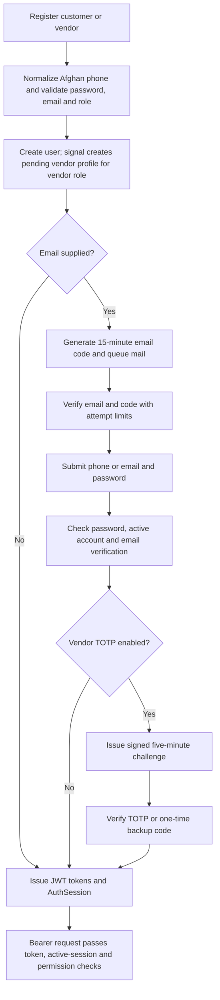
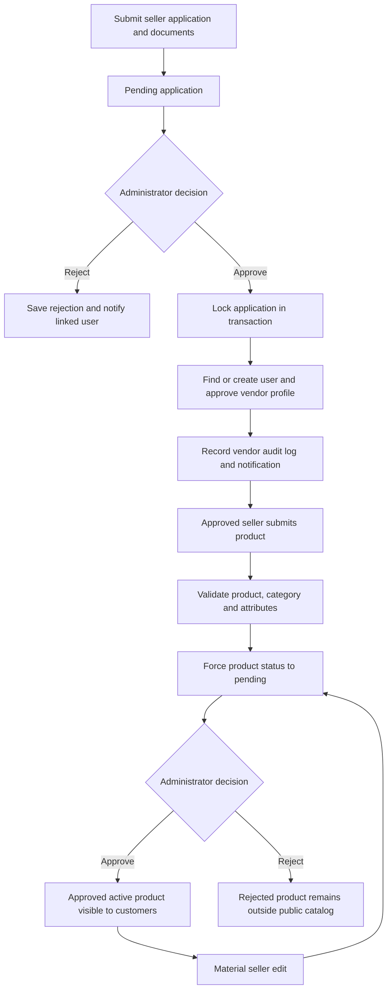
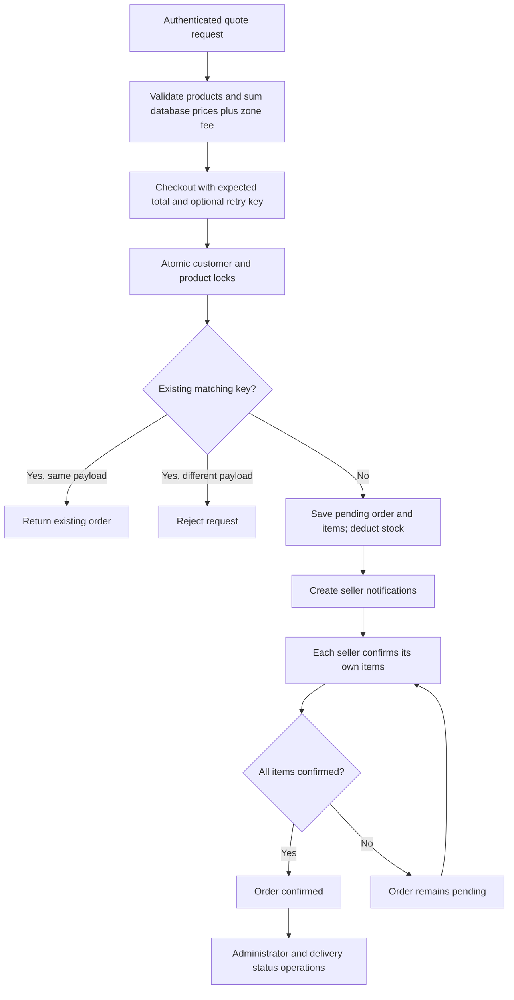
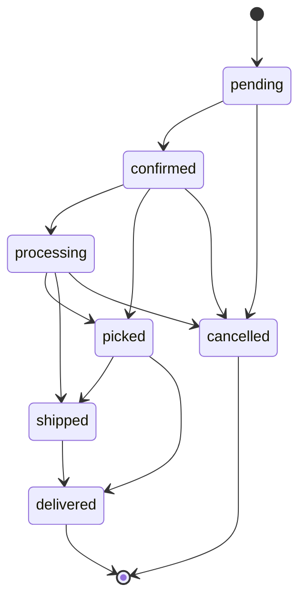
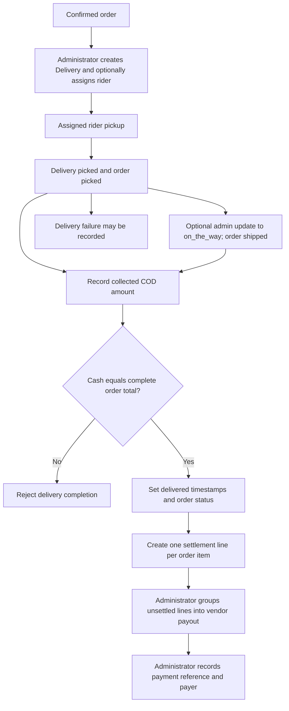

# Architecture and workflow reference

Source inspection and isolated runtime verification: 5 November 2026. See [README](../README.md) for the overall architecture, [database reference](DATABASE.md) for entities, and [audit](PROJECT_AUDIT.md) for defects. Solid diagram edges describe implemented calls; optional integrations require configuration and were not exercised remotely.

## Application boundaries

| Boundary | Source | Responsibility |
|---|---|---|
| Browser entry / routes | `frontend/src/main.tsx`, `src/app/App.tsx`, `src/routes/adminRoutes.tsx` | React SPA, lazy routes, error boundary and role navigation |
| API transport | `frontend/src/services/api.ts` | Axios base URL, language/token headers, one in-flight refresh, error translation |
| API dispatch | `backend/Bazar/urls.py`, `backend/api/urls.py` | Health, administration, explicit API paths and DRF router |
| Authorization | `home/views.py`, `home/admin_views.py`, `home/vendor_views.py` | Role checks, object checks and queryset filtering; these are not uniformly applied |
| Session authentication | `home/authentication.py`, `home/two_factor.py` | SimpleJWT plus AuthSession lookup, TOTP and backup codes |
| Domain services | `home/commerce.py`, `home/onboarding.py` | Transactions for checkout, inventory/status changes, seller approval and payout grouping |
| Representations / validation | `home/serializer.py` | Public/private representations, checkout limits, product/review/address rules |
| Persistence | `home/models.py`, `home/admin_models.py` | Django ORM entities and relationships in one configured SQL database |
| Storage | `home/storage.py`, `home/uploads.py`, `home/fields.py` | Private documents, validated uploads, optional TOTP encryption |
| Background email | `home/emails.py`, `management/commands/send_queued_mail.py` | Database outbox with bounded retries; separate worker process |

This is one deployable Django application, not independent identity/order/payment services. The separate `api` package is routing, not a second backend. `home/admin_models.py` is loaded in `HomeConfig.ready`. Frontend `src/pages` and `src/app/components` overlap; `App.tsx` identifies which page is active. Some older profile/listing/detail components are retained but do not back the active routes.

## State and data ownership

- The active cart and wishlist are browser `localStorage` arrays. Database Cart endpoints coexist without active storefront synchronization. Cart polling runs every 500 ms in `App.tsx`.
- Browser role checks control navigation; the server must independently enforce permissions. Editing localStorage is not a source of server authority.
- Monetary values in checkout are recomputed from Product and DeliveryZone. OrderItem stores price/name/vendor/commission snapshots, while current product metadata may still be returned alongside snapshots.
- Checkout holds a customer row lock and ordered product row locks. A hashed customer/idempotency key identifies retries; a payload digest rejects reuse with different data.
- `transaction.atomic` and `F` updates coordinate reservations and transitions. SQLite test success does not prove row-lock semantics; PostgreSQL is required.
- One order can contain multiple vendors, but there is one order-level status, one delivery record, and one delivery fee. Vendors confirm their own items; the order becomes confirmed when all are confirmed. Current order serialization fails to scope other vendors' items.
- Delivered order items produce one SettlementLine each. Payouts group unsettled lines by vendor and creation-date period. Recording a payout payment stores an administrator/reference; no bank API moves funds.
- Email is queued in the same database. The worker locks one available job, sends via configured Django mail, clears sent body content, and retries failures up to eight attempts. This is at-least-once delivery; a crash after SMTP success may cause a duplicate.

## Workflows

### Registration, verification and login

Backend tests verify the TOTP branch and backup-code consumption. Registration/email verification was inspected in source; SMTP delivery was not tested. Google sign-in verifies a Google ID token and uses a separate handler before issuing the same type of session; its external provider path remains unverified. Phone-less Google accounts use an internal synthetic identifier, so completing a usable phone/contact flow needs further testing.

### Seller onboarding and product moderation

There are also direct vendor registration and register-with-vendor-role paths; they are not equivalent to a completed application/document review. Identity-document links have a confirmed access-control flaw. The source returns materially edited listings to pending for name, description, price and category changes; image and attribute edits do not have identical moderation behavior.

### Purchasing and order transitions

The authoritative transition graph in `commerce.py` is:

Cancellation restores stock through this service. The buyer cancellation endpoint permits pending/confirmed orders only. The admin order-operations handler adds its own different transition map, while bulk updates accept another subset of status names. Generic deletion does not call cancellation and is an integrity defect, not an alternative fulfillment step.

### Delivery and settlement

Delivery failure leaves the order and stock in their existing state; a complete reattempt/return/refund process is not present. An administrator can also mark an order delivered directly through order endpoints, without going through cash collection validation. No courier API, location tracking, online payment gateway, or rider SPA is implemented. The diagram describes source behavior; a full browser-to-rider journey has not been tested.

## Integration and deployment boundaries

Storage settings select local filesystem or an S3-compatible backend, with a separate signed private bucket. Cloudflare R2 is a supported endpoint type, not a verified live resource. PostgreSQL can be hosted by any compatible provider; no Neon provisioning files or active Neon endpoint were verified.

Redis supplies shared cache for throttles and MFA when configured; local tests use LocMemCache. Sentry initialization is optional. SMTP requires a worker and valid mail configuration. No worker is declared in `railway.json`, and presence checks alone do not validate network reachability or bucket privacy. These must be demonstrated in an isolated staging environment before production claims.
