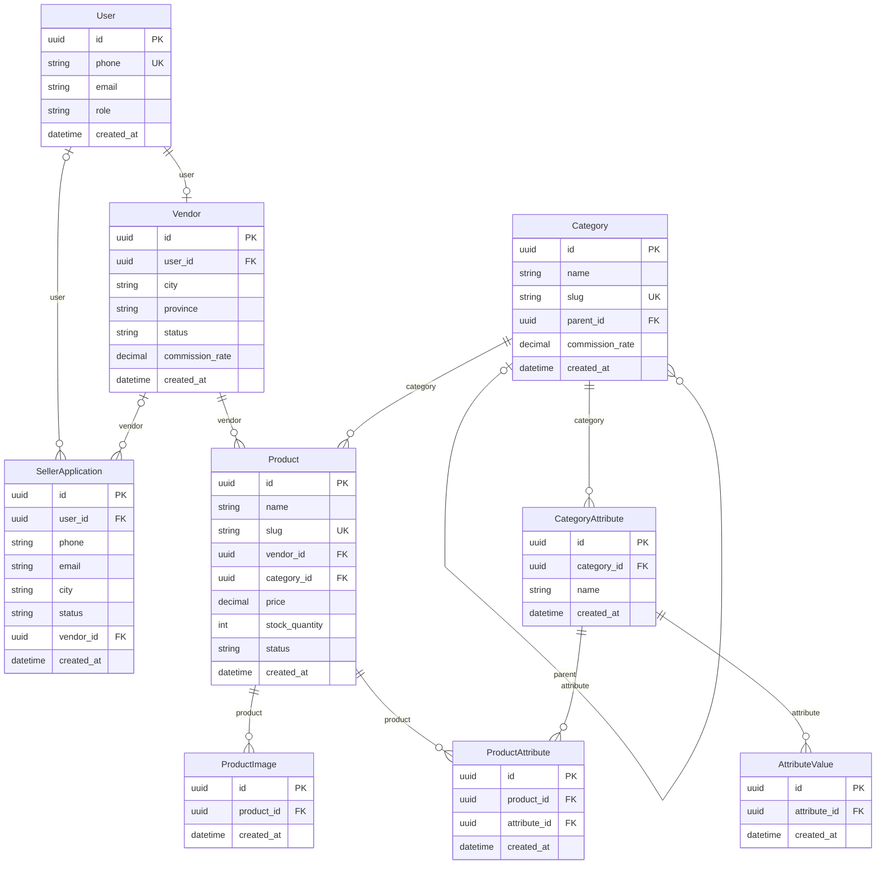
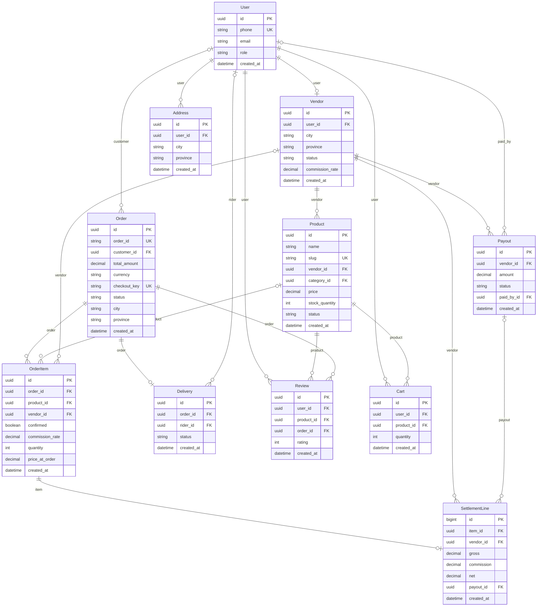
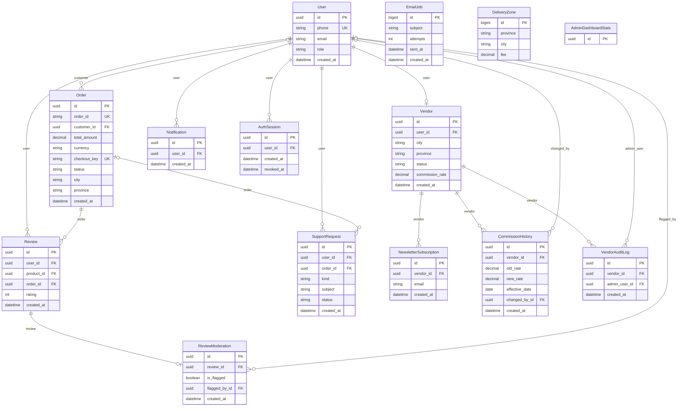

# Database design

Inspected on 2026-11-05 from Django model metadata, including `home/admin_models.py`. These diagrams describe the current local source, not an inspected production database. All 27 concrete home models are represented. Built-in Django admin, auth/group/permission, sessions and SimpleJWT blacklist tables are omitted. User also has many-to-many relationships with Django Group and Permission.

SQLite is the local fallback; configured production databases must use PostgreSQL. No Neon connection was found in the local backend configuration, and no remote database was contacted.

Mermaid uses actual Django class names. A child may be absent on the many side; a nullable foreign key permits no parent. Only selected scalar fields are shown; every concrete field is listed in [model-schema.json](evidence/model-schema.json).

## Identity, seller onboarding and catalog

## Purchasing, fulfillment and settlement

## Support, security and administration

## Integrity and indexing

| Model / relationship | Implemented constraint | Limitation |
|---|---|---|
| User | Unique normalized phone; UUID key | Email has no database uniqueness constraint; API paths differ in validation |
| Vendor / Delivery / SettlementLine | One-to-one user / order / order item respectively | Settlement and order deletion require explicit business rules |
| Category | Unique slug; `(name, level)` unique; parent, slug, level and active indexes | Maximum depth is enforced in `save`, not a database hierarchy constraint |
| CategoryAttribute / AttributeValue / ProductAttribute | Unique `(category, name)` / `(attribute, value)` / `(product, attribute)` | Attribute type and required-value enforcement need fuller validation |
| Product | Category deletion protected; vendor/category/slug/status/featured indexes | Positive price and commission ranges lack database check constraints |
| Order | Unique order reference and nullable unique checkout key | No database check for total = subtotal + fee |
| OrderItem | Vendor protected; product nullable with snapshot name and price | PositiveIntegerField permits zero at the database level; API enforces at least one |
| DeliveryZone | Unique `(province, city)`; fee >= 0 check | Case-sensitive uniqueness differs from case-insensitive lookup |
| Review / Cart / NewsletterSubscription | Unique `(user, product, order)` / `(user, product)` / `(vendor, email)` | No cross-device wishlist model is active |
| Address | Default address cleared in `save` | No conditional unique constraint for one default address under concurrent writes |
| CommissionHistory | Vendor/date index | `effective_date` uses `auto_now_add`; scheduled changes are not implemented |

`EmailJob`, `DeliveryZone` and `SettlementLine` use Django-generated integer primary keys; the project does not use UUIDs for every model.

## Migrations

The home migration chain contains `0001` through `0022`. A fresh isolated SQLite migration run succeeded, and `makemigrations --check --dry-run --settings=Bazar.test_settings` reported no changes. Existing migration 0019 has local edits and 0020?0022 were untracked at intake; publishing this audited snapshot includes them. Existing installed databases were not inspected or migrated. PostgreSQL migration and concurrent checkout remain to be executed against a disposable PostgreSQL instance.
